# Activity and social-signal models: data, method and results

_Generated 2026-11-09 18:39 by `model_harry/run_full_pipeline.py` from the tables in `final_run/tables/`. Every number below is computed, not typed; re-running the pipeline regenerates this file. Figures are in `final_run/figures/` (PNG to view, PDF for the report) and all of them, with captions, are in `final_run/index.html`._

> **How to use this document.** It is deliberately longer than the 4,000-word report allows. Each section maps to a part of the report (Methodology → physical activity recognition / social signal classification / testing; Results and Discussion → model accuracy / critical analysis). Take the paragraphs, tables and figures you need. Sections marked **[fill in]** need results only you can produce (the live real-time test on the phone).

## 1. Headline results (official subject-wise 10-fold cross-validation)

Marked as in the CW3 brief: recall of each class on the held-out fold, averaged over the 10 official folds; group means as stated. **Headline** = training folds use datasetJan2026 **plus** the two group members' recordings (datasetJan2026 + group recordings); **strict** = datasetJan2026 only, exactly as provided. Test folds are always datasetJan2026 only. Values: mean over 3 training seeds; ± = standard deviation over the 10 folds (seed 0).

| task | class | headline | strict (Jan2026 only) | target | pass (headline) |
|---|---|---|---|---|---|
| activity | sitting/standing | 95.6 ± 4.3 | 97.3 ± 4.2 | (static ≥ 90 % mean) |  |
| activity | lying on back | 100.0 ± 0.0 | 99.4 ± 1.5 | (static ≥ 90 % mean) |  |
| activity | lying left | 99.5 ± 1.9 | 100.0 ± 0.0 | (static ≥ 90 % mean) |  |
| activity | lying right | 100.0 ± 0.0 | 100.0 ± 0.0 | (static ≥ 90 % mean) |  |
| activity | lying on stomach | 100.0 ± 0.1 | 99.7 ± 0.9 | (static ≥ 90 % mean) |  |
| activity | walking | 85.4 ± 5.8 | 89.6 ± 6.3 | (dynamic ≥ 85 % mean) |  |
| activity | shuffle walking | 75.2 ± 9.7 | 88.0 ± 7.1 | (dynamic ≥ 85 % mean) |  |
| activity | ascending stairs | 86.9 ± 6.1 | 93.6 ± 4.4 | (dynamic ≥ 85 % mean) |  |
| activity | descending stairs | 85.6 ± 5.9 | 92.7 ± 4.6 | (dynamic ≥ 85 % mean) |  |
| activity | running | 92.5 ± 2.9 | 97.0 ± 2.2 | (dynamic ≥ 85 % mean) |  |
| activity | miscellaneous movements | 82.8 ± 5.7 | 83.4 ± 3.3 | (dynamic ≥ 85 % mean) |  |
| social | normal breathing | 87.3 ± 2.4 | 87.1 ± 2.7 | ≥ 75 % | ✓ |
| social | coughing | 82.0 ± 4.4 | 81.9 ± 3.8 | ≥ 75 % | ✓ |
| social | hyperventilation | 80.7 ± 2.5 | 81.0 ± 2.9 | ≥ 75 % | ✓ |
| social | other | 80.8 ± 1.5 | 80.2 ± 1.2 | ≥ 75 % | ✓ |
| activity | **static mean (5 classes)** | **99.0** ± 1.0 | 99.3 ± 0.8 | ≥ 90 % | ✓ |
| activity | **dynamic mean (6 classes)** | **84.8** ± 2.3 | 90.7 ± 1.7 | ≥ 85 % | ✗ |
| social | **social balanced (4 classes)** | **82.7** ± 1.3 | 82.6 ± 1.3 | ≥ 75 % | ✓ |

In words: static activities reach **99.0 %** (target 90 %), dynamic activities **84.8 %** (target 85 %), and the weakest social class reaches **78.7 %** (target 75 % for every class). Seed-to-seed standard deviation of the group scores: static 0.17, dynamic 0.15, social 0.17 percentage points, so differences smaller than about twice these are within run-to-run noise.

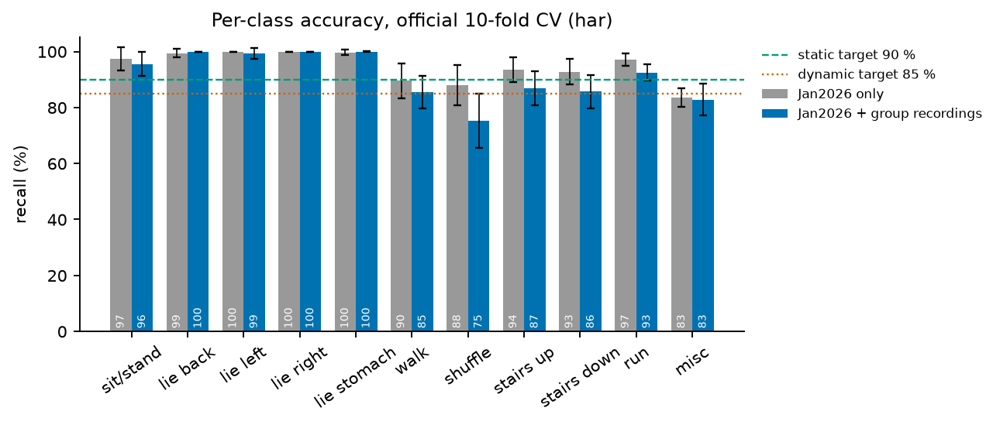

*Per-class accuracy, official 10-fold CV (har): Mean over the 10 official folds of each class's recall (the marked number), error bars = sd over folds. Both training-data variants shown.* (vector: `figures/results/per_class_har.pdf`)

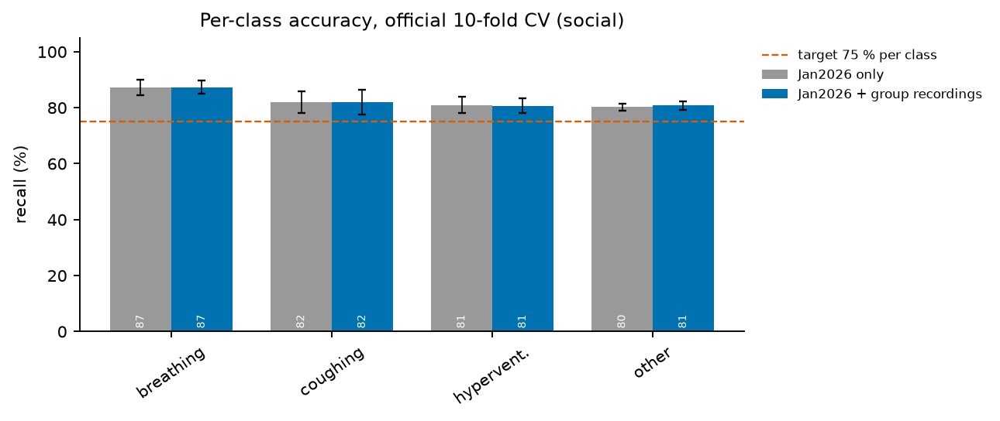

*Per-class accuracy, official 10-fold CV (social): Mean over the 10 official folds of each class's recall (the marked number), error bars = sd over folds. Both training-data variants shown.* (vector: `figures/results/per_class_social.pdf`)

## 2. Data

### 2.1 datasetJan2026 (the provided dataset)

RESpeck chest-worn tri-axial accelerometer, 12.5 Hz, values in g. Two parts:

- **Daily activity** (11 classes): 1869 recordings (15.77 h) listed in the official fold file, plus 50 files on disk that the fold file does not list.
- **Social signals** (4 classes): 6440 listed recordings (54.24 h), plus 52 unlisted files.

| task | class | recordings | mean length (s) | shortest (s) | test windows (2 s step) |
|---|---|---|---|---|---|
| har | ascending stairs | 163 | 30.3 | 28.0 | 2268 |
| har | descending stairs | 146 | 30.2 | 28.2 | 2023 |
| har | lying on back | 155 | 30.3 | 28.0 | 2149 |
| har | lying left | 117 | 30.3 | 26.3 | 1621 |
| har | lying right | 113 | 30.2 | 28.0 | 1561 |
| har | lying on stomach | 172 | 30.3 | 28.0 | 2388 |
| har | miscellaneous movements | 163 | 30.3 | 28.0 | 2269 |
| har | walking | 166 | 30.3 | 28.0 | 2304 |
| har | running | 168 | 30.2 | 25.2 | 2324 |
| har | shuffle walking | 164 | 30.3 | 28.0 | 2273 |
| har | sitting/standing | 342 | 30.8 | 28.0 | 4834 |
| social | normal breathing | 1047 | 30.6 | 26.3 | 12573 |
| social | coughing | 977 | 30.2 | 25.8 | 11586 |
| social | hyperventilation | 1024 | 30.3 | 20.4 | 12153 |
| social | other | 3392 | 30.3 | 26.7 | 40305 |

Sitting and standing are one class (as required); talking, eating, singing and laughing form the single social class *other*. Classes are imbalanced: *other* holds about half of the social data, which drives the class-weighting choice (§4.2).

**Official folds.** `folds_daily_activity.csv` and `folds_social_signal.csv` assign every listed recording to one of 10 folds. As the brief explains, subject IDs are not shared across activities, so folds are defined per activity; the same file name (e.g. `N_0.csv`) in two class folders is two different subjects. Every fold contains every class (`fold_composition_*` figures).

**Unlisted recordings.** The fold files omit 102 recordings that are present on disk. None is a byte-copy of a listed file, so they come from subjects whose fold is unknown. Putting them in a training fold could place a test subject in training, so they are **excluded from cross-validation** and used only when training on 'all of datasetJan2026' (leave-one-person-out and the final deployed models).

**Duplicated recordings across the two tasks.** 899 static daily-activity recordings are byte-for-byte copies of social-signal recordings (the static activity data *is* the normal-breathing social data). The two fold files put only 90 of these pairs in the same fold. This does not affect the marked scores (each task is cross-validated on its own), but it matters when one model's output is used to evaluate the other (the social gate, §5.5): there the HAR model of fold *k* is retrained without any copy of fold *k*'s social test recordings. It also means datasetJan2026 has **no static activity data recorded while coughing, hyperventilating or talking** – only calm breathing – which explains why a Jan2026-only HAR model mistakes some coughs for movement (§6.9).

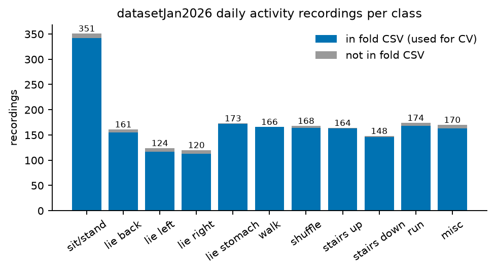

*datasetJan2026 daily activity recordings per class: Number of recordings per class. Grey: files present on disk but not listed in the official fold CSV (unknown subjects; excluded from CV, used only to train the final models).* (vector: `figures/data/recordings_per_class_har.pdf`)
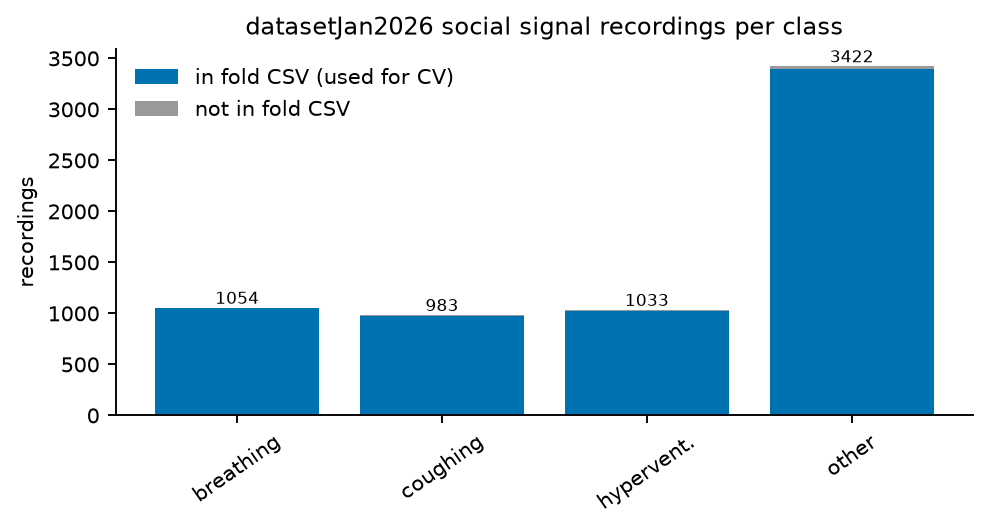

*datasetJan2026 social signal recordings per class: Number of recordings per class. Grey: files present on disk but not listed in the official fold CSV (unknown subjects; excluded from CV, used only to train the final models).* (vector: `figures/data/recordings_per_class_social.pdf`)
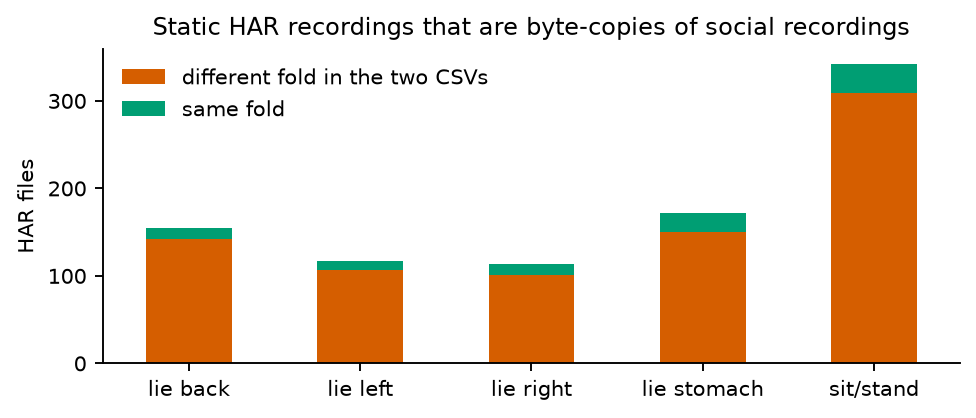

*Static HAR recordings that are byte-copies of social recordings: Every static daily-activity file is a copy of a social-signal recording (breathing). The two official fold CSVs mostly place the copies in different folds.* (vector: `figures/data/duplicates.pdf`)

### 2.2 Group recordings

Both group members recorded the full CW2 protocol with the RESpeck and the app: Subject A (s2503795) 44 recordings, Subject B (s2952925) 44 recordings. Per person: sitting and standing and the four lying postures, each while breathing normally, coughing, hyperventilating, talking, eating (sitting/standing only), singing and laughing, plus the six dynamic activities. File names give the labels.

**Quality checks** (`tables/real_data_quality.csv`): sampling rate from timestamps 12.14 Hz median (range 8.56–13.32); missing values in 0 recordings; longest flat run 2 samples; clipped samples 0. Sensor placement was checked by comparing each recording's gravity direction with the datasetJan2026 mean for the same class: median angle 13.4°, 0 recording(s) flagged (> 35° or another issue).

Use in this project: added to the training data of every fold (headline variant), used as unseen test people in the leave-one-person-out experiments (§5.4), and in the final models. They never appear in a datasetJan2026 test fold.

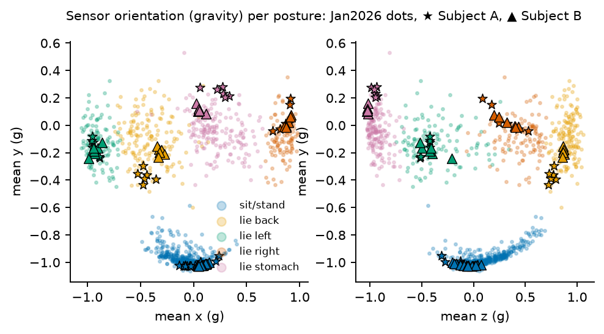

*Gravity orientation per posture: Mean acceleration of each static recording (= gravity direction = posture). Group members' recordings (large markers) fall inside the Jan2026 clusters, so sensor placement matches the dataset.* (vector: `figures/data/gravity_orientation.pdf`)
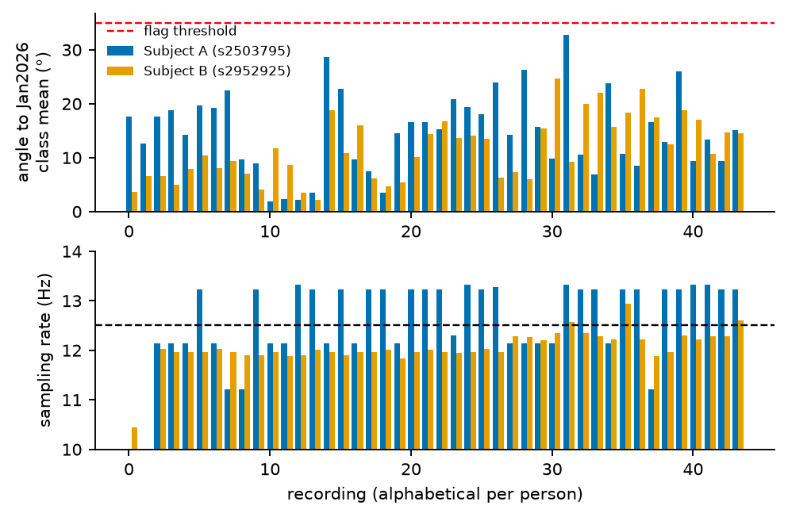

*Group recordings: quality checks: Per recording of each group member: angle between its gravity vector and the Jan2026 mean for the same class (placement check) and the sampling rate estimated from timestamps (nominal 12.5 Hz).* (vector: `figures/data/real_data_quality.pdf`)

## 3. Pre-processing, features and models

### 3.1 Windowing

Both models classify fixed windows of raw acceleration: **4 s (50 samples) for activities** and **8 s (100 samples) for social signals**. Activities are periodic at 1–3 Hz, so 4 s holds several gait cycles while staying responsive. Breathing runs at roughly 0.2–0.5 Hz (one breath every 2–5 s), so the social window needs to hold at least two full breaths; earlier cross-validation of a 4 s social window lost 4.5 points of balanced accuracy and coughing fell from 82.4 % to 75.2 %. Training windows overlap (step 25 samples = 2 s on datasetJan2026, step 6 on the much smaller group data); test windows use a 2 s step. In the app a new result is produced every 0.5, 1 or 2 s (Settings) from the latest window.

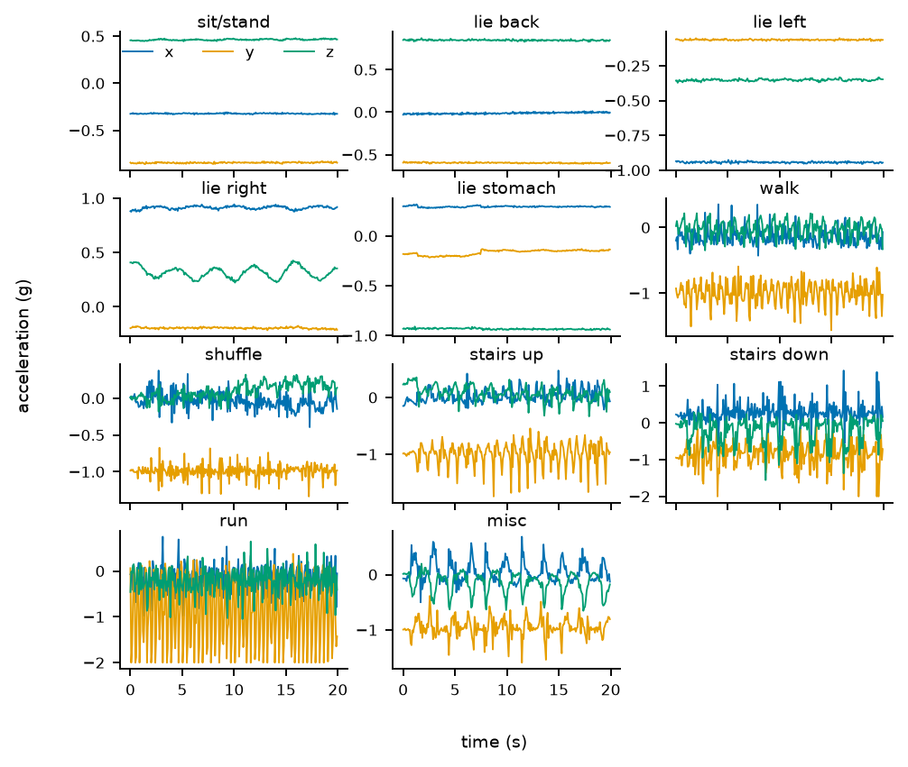

*Example raw signals (har): First 20 s of one recording per class (x, y, z in g). Posture shows up as the constant offset (gravity), activity as the oscillation around it.* (vector: `figures/data/example_signals_har.pdf`)
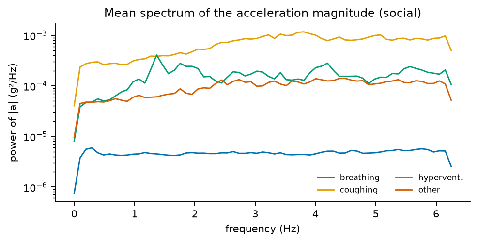

*Mean spectrum of the acceleration magnitude (social): Welch power spectrum of the gravity-free acceleration magnitude, averaged over up to 200 recordings per class. These frequency bands motivate the in-model band-power features.* (vector: `figures/data/spectra_social.pdf`)

### 3.2 Pre-processing inside the model

All pre-processing is part of the TensorFlow graph, so the phone feeds raw g values and the exact same computation runs in training and in the app (no feature code to keep in sync in Dart). Every operation lowers to a TFLite builtin op (checked at export).

1. **Gravity split.** Gravity (= posture) is the mean of each axis over the window; the dynamic part is the window minus that mean. Posture and motion are therefore separate inputs instead of being mixed in one normalised signal – important because breathing signals are ~0.007 g while gravity is 1 g.
2. **Dynamic channels** (7): gravity-free x, y, z; magnitude |a| minus its mean (orientation-free); first difference of x, y, z (jerk).
3. **Spectral features**: log mean power in fixed frequency bands, computed with a Hann-tapered DFT written as a matrix multiply. Activity bands [(0.3, 1.0), (1.0, 1.5), (1.5, 2.0), (2.0, 2.5), (2.5, 3.5), (3.5, 6.26)] Hz; social bands [(0.1, 0.4), (0.4, 0.8), (0.8, 1.5), (1.5, 3.0), (3.0, 6.26)] Hz (breathing, fast breathing, coughs/voice). Plus log standard deviation of every dynamic channel (scale-free intensity).
4. **Normalisation**: per-branch z-scoring whose statistics are fitted on the training windows of each fold only.
5. **Augmentation (training only)**: random rotation about the body axis (±30°), small random tilt (±10°), amplitude scaling (0.8–1.25 of the dynamic part) and Gaussian noise (0.002 g), applied on the fly so every epoch sees new variants. This targets the main real-world variation: how the sensor sits on each person.

### 3.3 Activity model: multi-branch CNN

Three branches are concatenated, then Dropout 0.3 → Dense 64 (ReLU) → Dropout 0.3 → Dense 11 (softmax):

- **Gravity branch** – normalised gravity vector → Dense 16: posture (sitting vs the four lying positions).
- **Convolution branch** – normalised dynamic channels → four Conv1D blocks (32 k5, 32 k5 dilation 2, max-pool, 64 k3; each Conv → BatchNorm → ReLU) → global average **and** global max pooling: motion shape; max pooling keeps short impacts (stairs, misc).
- **Spectral branch** – band powers and log-std → Dense 32: cadence and intensity.

### 3.4 Social model: convolutional-recurrent network (Conv-GRU)

Same gravity and spectral branches (gravity Dense 8), but the sequence branch is a Conv1D stem (32 k5, BatchNorm, ReLU, max-pool 2) followed by a **GRU with 48 units** over the remaining 50 steps, then Dropout 0.3. The recurrent layer models the order of events inside the 8 s window (inhale/exhale rhythm, a burst followed by recovery). It is trained with `unroll=False` and exported with an unrolled copy so TFLite needs builtin ops only.

| task | model | params | size_kb | ms_per_window | parity_argmax_agreement |
|---|---|---|---|---|---|
| har | harry_cnn (final, trained) | 26112 | 133.1 | 0.026 | 1.0 |
| social | harry_rnn (final, trained) | 20017 | 294.2 | 0.101 | 1.0 |

### 3.5 Baselines (for the comparison)

Trained and tested on exactly the same folds and data: the Lab 3 models (MLP, CNN – the original app model –, LSTM, and logistic regression on 28 per-window statistics), and our own simpler variants (gravity-split MLP; spectral-feature network without the sequence branch; the CNN for social and the GRU for activities). Lab 3 models keep their own recipe (Adam 1e-3, 32 epochs, 4 s windows); ours use §4.

## 4. Training

### 4.1 Recipe

| setting | value |
|---|---|
| optimiser | AdamW, weight decay 1e-4 |
| learning rate | 2e-3 with cosine decay to 5 % |
| epochs | 32, fixed in advance (no early stopping on test folds) |
| batch | 64 |
| loss | categorical cross-entropy, label smoothing 0.1 |
| class weights | activities: balanced; social: balanced^0.6 (§4.2) |
| augmentation | §3.2 |
| group data (activities) | train on datasetJan2026, then fine-tune on the group recordings: AdamW 5e-4, 30 epochs, step 6 |
| group data (social) | mixed into the datasetJan2026 training set (windows every 6 samples) |
| seeds | 0, 1, 2 |

Why the two tasks use the group data differently: fine-tuning the activity model on group recordings adds what datasetJan2026 lacks (stationary postures while coughing, talking, …) and improved accuracy on an unseen person; fine-tuning the social model on one person over-fitted to that person's breathing (unseen-person balanced accuracy fell). Mixing keeps datasetJan2026 dominant. The leave-one-person-out results (§6.8) re-test all three options.

### 4.2 Class weighting for social signals

With fully balanced weights each class contributes equally to the loss, so the majority class *other* (~53 % of windows) is under-predicted and was the only class below 75 %. Weights are therefore softened to w_c = (N / (K·n_c))^0.6. The exponent follows from the class proportions: with balanced weights the effective prior of *other* is divided by ~3.3 (its share over the mean share of the others); a power of 0.6 leaves a factor of 3.3^0.4 ≈ 1.6, trading 2–4 points on the three smaller classes for ~7 points on *other*. The sweep in §6.6 shows the whole trade-off curve.

### 4.3 Compute

Apple M1 Pro, 8 CPU cores, macOS-26.5.2-arm64-arm-64bit; Python 3.12.14, TensorFlow 2.21.0, Keras 3.15.1, scikit-learn 1.9.1. CPU only. 348 training/testing jobs, 29.8 CPU-job hours in total.

| job group | jobs | seconds total | seconds per job |
|---|---|---|---|
| baseline | 140 | 21257.0 | 152.0 |
| deploy | 16 | 18.0 | 1.0 |
| final | 2 | 767.0 | 384.0 |
| gate | 20 | 2861.0 | 143.0 |
| lopo | 10 | 2791.0 | 279.0 |
| main | 120 | 52004.0 | 433.0 |
| sweep | 40 | 27686.0 | 692.0 |

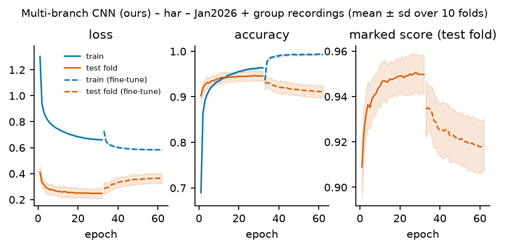

*Learning curves (har, Jan2026 + group recordings): Training and held-out-fold loss/accuracy per epoch, mean ± sd over the 10 official folds. The test fold was only monitored, never used to stop or tune training (fixed epochs, as in Lab 3).* (vector: `figures/training/learning_curves_har_jan_real.pdf`)
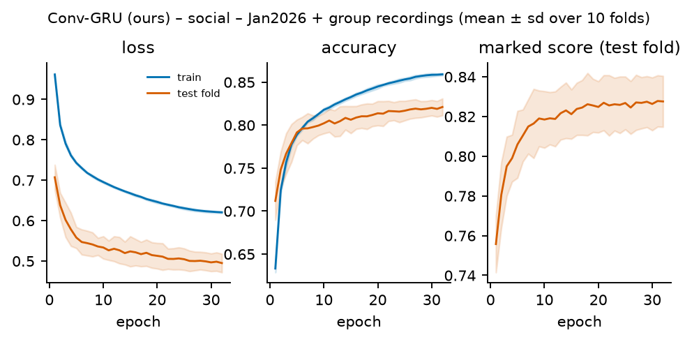

*Learning curves (social, Jan2026 + group recordings): Training and held-out-fold loss/accuracy per epoch, mean ± sd over the 10 official folds. The test fold was only monitored, never used to stop or tune training (fixed epochs, as in Lab 3).* (vector: `figures/training/learning_curves_social_jan_real.pdf`)

## 5. Evaluation protocol

### 5.1 Marked cross-validation

For each fold k = 0…9: a new model is trained from scratch on every listed recording not in fold k (plus the group recordings in the headline variant) and tested on fold k. Within each activity a subject is never in both sets (guaranteed by the official fold file). A test *sample* is a window; windows are taken every 2 s. For each class, accuracy = share of its test windows classified correctly (recall); the reported figure is the mean of this over the 10 folds; group scores average the per-class values (static: 5 classes, dynamic: 6, social: each of 4 checked against 75 %). Baseline models with 4 s social windows are scored on the last 4 s of the same 8 s test windows, so every model is judged at the same moments.

### 5.2 Additional metrics
Precision, F1, macro ROC-AUC, recording-level majority vote, log-loss, expected calibration error, per-fold and per-seed spread, 95 % confidence intervals over folds, and paired Wilcoxon signed-rank tests over the 10 folds (a non-parametric test suited to 10 paired values; with n = 10 the smallest attainable two-sided p is 0.002).

### 5.3 Seeds
The final recipes are repeated with 3 seeds (different weight initialisation, augmentation and batch order) to separate real differences from training noise.

### 5.4 Leave-one-person-out (real users)
Each group member is tested with models that never saw them: (A) trained on all of datasetJan2026, (B) A's data plus the other member mixed in, (C) model A fine-tuned on the other member. Test windows every 2 s.

### 5.5 Social only while stationary (gate)
Following the formative feedback, social results are only meaningful when the wearer is not moving. The gate uses the activity model's result for the last 4 s of each social window. Measured: how often social is wrongly hidden on stationary data, and how often moving windows would wrongly enable it.

### 5.6 Simulated real-time behaviour
Each member's recordings were streamed back to back in 5 random orders through the leave-that-person-out models with the final strategies, at the app's update intervals (2 / 1 / 0.5 s): accuracy of what the app shows (activity: raw and with the app's majority-of-3 smoothing; social: raw and gated) and latency after each change of activity (first correct result; three correct in a row). A 'trial' simulation replays each recording from a cold start, like a trial in the app's real-time test.

## 6. Results

### 6.1 Group scores and per-class accuracy

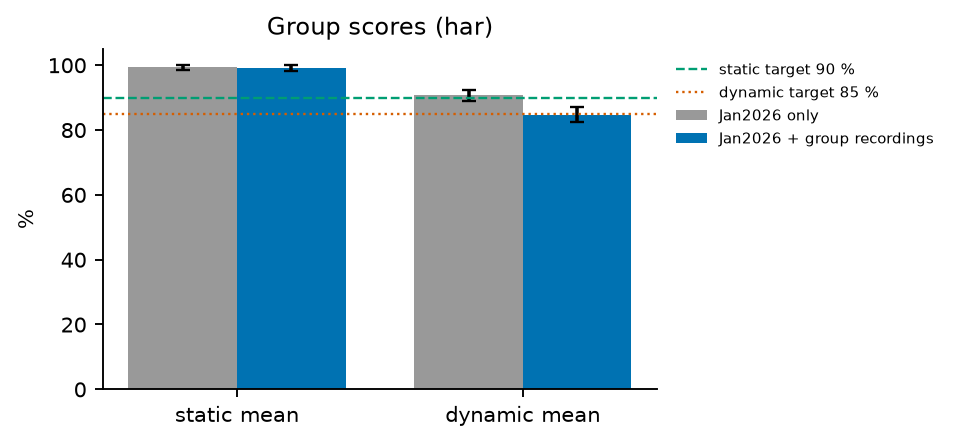

*Group scores (har): Marked group scores (mean over folds and seeds); error bars = sd over folds.* (vector: `figures/results/group_scores_har.pdf`)
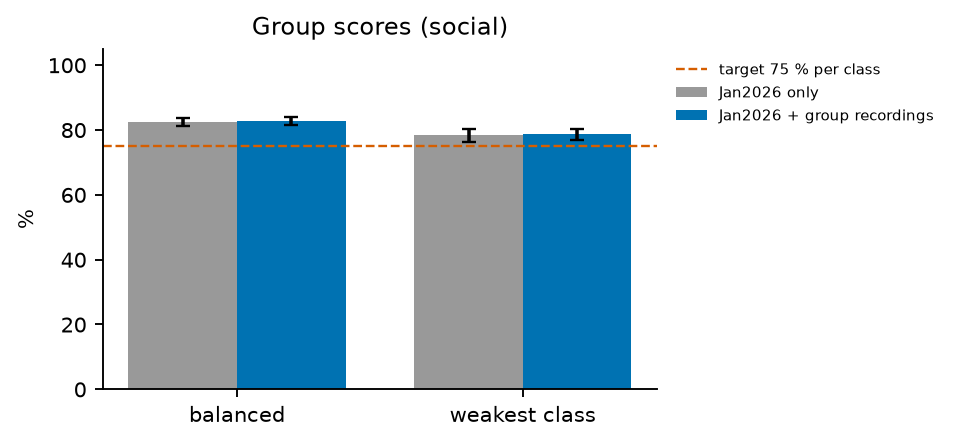

*Group scores (social): Marked group scores (mean over folds and seeds); error bars = sd over folds.* (vector: `figures/results/group_scores_social.pdf`)

**Activities (datasetJan2026 + group recordings)**

| class | recall | fold sd | seed sd | 95 % CI ± | worst fold | best fold | precision | F1 |
|---|---|---|---|---|---|---|---|---|
| sitting/standing | 95.6 | 4.3 | 0.55 | 3.1 | 88.2 | 100.0 | 92.4 | 93.9 |
| lying on back | 100.0 | 0.0 | 0.00 | 0.0 | 100.0 | 100.0 | 94.5 | 97.1 |
| lying left | 99.5 | 1.9 | 0.28 | 1.4 | 93.9 | 100.0 | 99.7 | 99.6 |
| lying right | 100.0 | 0.0 | 0.00 | 0.0 | 100.0 | 100.0 | 99.9 | 99.9 |
| lying on stomach | 100.0 | 0.1 | 0.02 | 0.1 | 99.6 | 100.0 | 99.4 | 99.7 |
| walking | 85.4 | 5.8 | 0.88 | 4.2 | 78.1 | 95.1 | 89.9 | 87.3 |
| shuffle walking | 75.2 | 9.7 | 0.78 | 7.0 | 56.5 | 88.2 | 73.8 | 74.2 |
| ascending stairs | 86.9 | 6.1 | 1.79 | 4.4 | 73.9 | 93.3 | 96.4 | 91.3 |
| descending stairs | 85.6 | 5.9 | 0.75 | 4.2 | 75.5 | 93.8 | 93.0 | 89.1 |
| running | 92.5 | 2.9 | 0.98 | 2.0 | 90.3 | 98.7 | 96.0 | 94.1 |
| miscellaneous movements | 82.8 | 5.7 | 0.51 | 4.1 | 72.5 | 89.2 | 77.1 | 79.5 |

**Social signals (datasetJan2026 + group recordings)**

| class | recall | fold sd | seed sd | 95 % CI ± | worst fold | best fold | precision | F1 |
|---|---|---|---|---|---|---|---|---|
| normal breathing | 87.3 | 2.4 | 0.14 | 1.7 | 82.0 | 90.7 | 71.9 | 78.8 |
| coughing | 82.0 | 4.4 | 0.66 | 3.2 | 76.0 | 88.3 | 75.3 | 78.4 |
| hyperventilation | 80.7 | 2.5 | 0.38 | 1.8 | 77.0 | 85.1 | 80.6 | 80.6 |
| other | 80.8 | 1.5 | 0.27 | 1.1 | 79.2 | 84.1 | 89.1 | 84.7 |

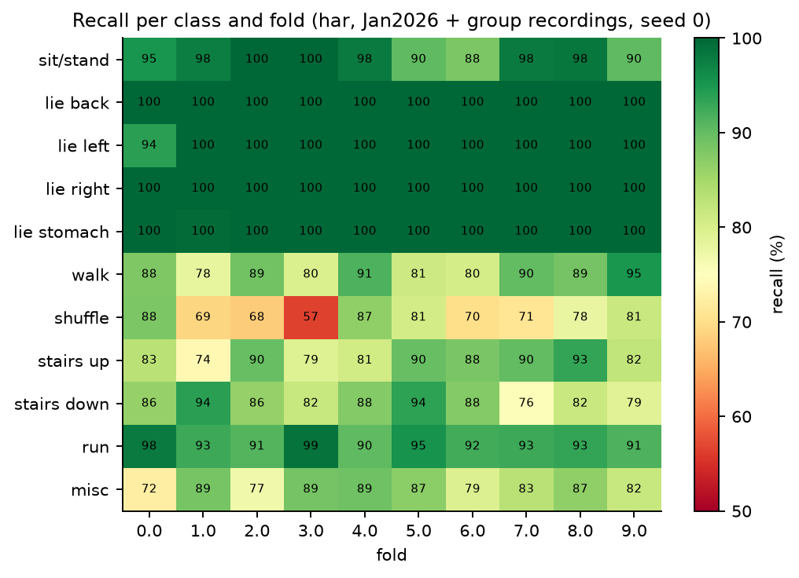

*Recall per class and fold (har, Jan2026 + group recordings, seed 0): Every fold's recall per class: shows which folds (groups of subjects) are hard.* (vector: `figures/results/fold_heatmap_har_jan_real.pdf`)
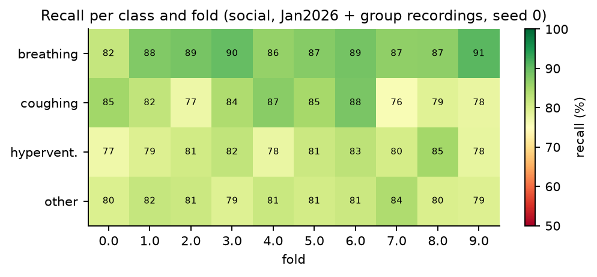

*Recall per class and fold (social, Jan2026 + group recordings, seed 0): Every fold's recall per class: shows which folds (groups of subjects) are hard.* (vector: `figures/results/fold_heatmap_social_jan_real.pdf`)
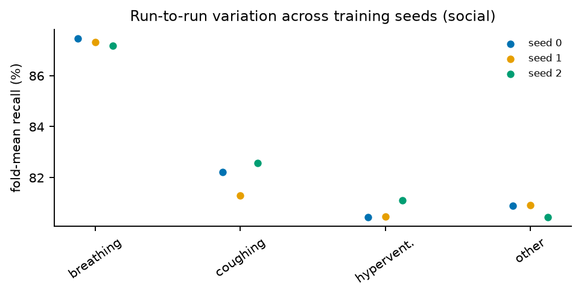

*Run-to-run variation across training seeds (social): The marked number for each of the 3 training seeds: the spread shows how much of a difference between models could be chance.* (vector: `figures/results/seed_variation_social.pdf`)

### 6.2 Other metrics

| task | variant | window accuracy % | macro F1 % | macro AUC % | recording vote % | ECE % | log-loss |
|---|---|---|---|---|---|---|---|
| har | jan | 94.6 | 94.5 | 99.5 | 96.6 | 6.6 | 0.248 |
| har | jan+real | 91.2 | 91.4 | 99.1 | 93.6 | 8.4 | 0.364 |
| social | jan | 81.7 | 80.4 | 95.5 | 86.6 | 2.9 | 0.501 |
| social | jan+real | 82.0 | 80.6 | 95.6 | 86.9 | 3.0 | 0.496 |

Recording vote = the majority class over all windows of a test recording; higher than window accuracy because isolated errors are out-voted, which is what the app's smoothing exploits. ECE = expected calibration error (gap between confidence and accuracy).

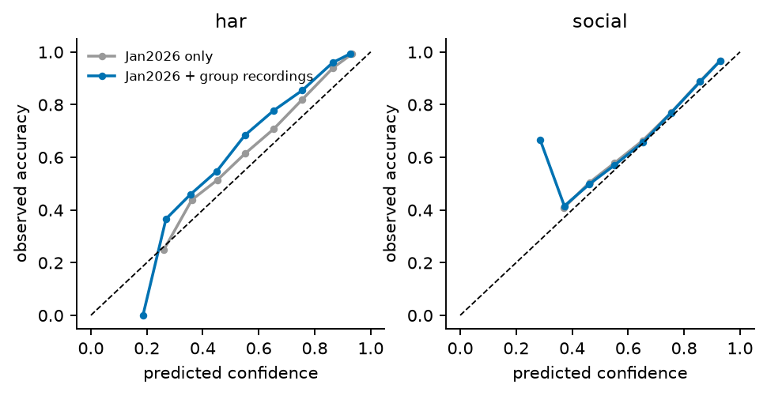

*Reliability diagram: Accuracy of test windows grouped by the model's confidence. On the diagonal = confidence can be trusted (e.g. for showing a confidence value in the app).* (vector: `figures/results/calibration.pdf`)
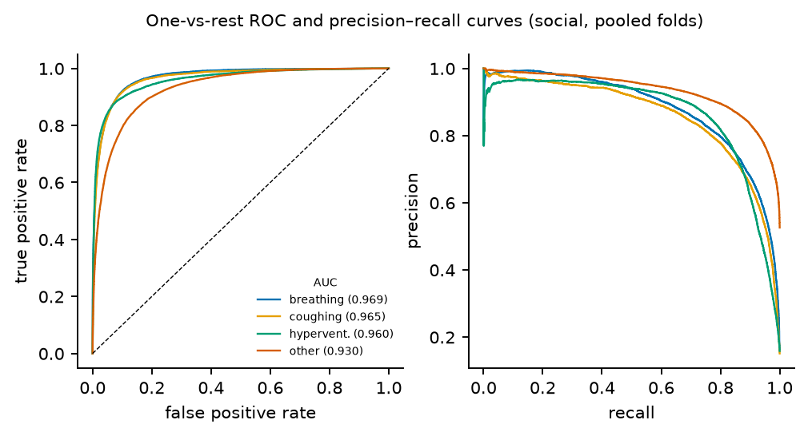

*ROC and PR curves (social): Per-class ROC (with AUC) and precision–recall curves of the headline models, all test windows pooled.* (vector: `figures/results/roc_pr_social.pdf`)

### 6.3 Confusions

Most frequent activity confusions (share of the true class, all folds pooled):

- **shuffle walking → sitting/standing**: 10.5 % of shuffle walking windows (239 windows).
- **shuffle walking → miscellaneous movements**: 8.3 % of shuffle walking windows (188 windows) – miscellaneous movements contain small steps, turns and weight shifts that look like slow, irregular shuffling over a 4 s window.
- **miscellaneous movements → shuffle walking**: 8.2 % of miscellaneous movements windows (187 windows) – miscellaneous movements contain small steps, turns and weight shifts that look like slow, irregular shuffling over a 4 s window.
- **descending stairs → shuffle walking**: 7.1 % of descending stairs windows (143 windows) – careful stair descent has short, low-amplitude steps like shuffling.
- **walking → shuffle walking**: 6.7 % of walking windows (155 windows) – both are level walking at a similar cadence; shuffling only shortens the stride and lowers the vertical bounce, so a chest sensor sees a scaled-down version of the same rhythm.
- **ascending stairs → walking**: 5.3 % of ascending stairs windows (121 windows) – stair climbing is walking with an extra vertical component that is small at chest level.

Most frequent social confusions (share of the true class, all folds pooled):

- **coughing → other**: 12.3 % of coughing windows (1420 windows) – laughing and some eating movements produce short abdominal bursts that resemble coughs.
- **normal breathing → other**: 10.9 % of normal breathing windows (1374 windows) – talking, eating, singing and laughing are intermittent: an 8 s window often contains pauses that are just normal breathing, and the vocal vibrations are small at 12.5 Hz.
- **hyperventilation → other**: 9.9 % of hyperventilation windows (1206 windows) – singing and laughing involve deep, fast breaths like hyperventilation.
- **other → normal breathing**: 9.5 % of other windows (3817 windows) – talking, eating, singing and laughing are intermittent: an 8 s window often contains pauses that are just normal breathing, and the vocal vibrations are small at 12.5 Hz.
- **other → coughing**: 6.0 % of other windows (2418 windows) – laughing and some eating movements produce short abdominal bursts that resemble coughs.
- **hyperventilation → coughing**: 5.5 % of hyperventilation windows (667 windows) – both produce strong, fast chest movements; a run of coughs and forced rapid breathing overlap in amplitude and rate.

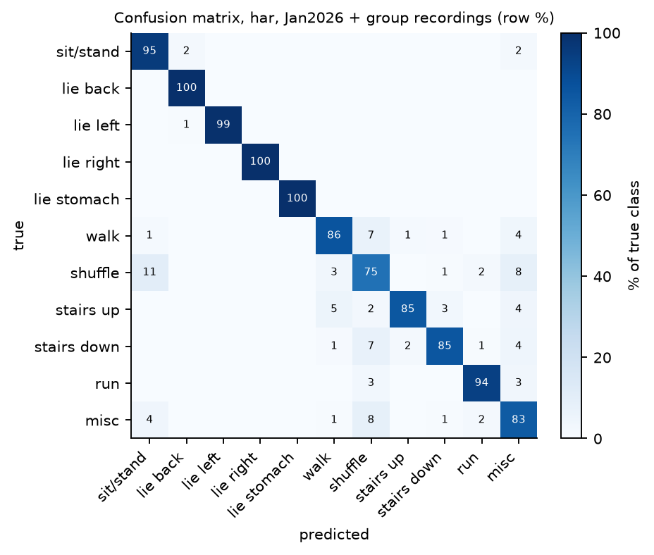

*Confusion matrix, har, Jan2026 + group recordings (row %): All test windows of the 10 folds pooled (seed 0). Rows = true class; the diagonal is the recall.* (vector: `figures/results/confusion_har_jan_real_pct.pdf`)
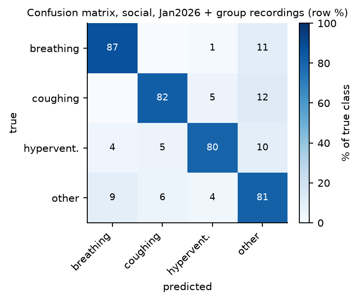

*Confusion matrix, social, Jan2026 + group recordings (row %): All test windows of the 10 folds pooled (seed 0). Rows = true class; the diagonal is the recall.* (vector: `figures/results/confusion_social_jan_real_pct.pdf`)
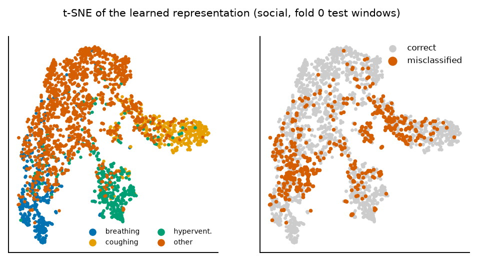

*t-SNE embedding (social): Penultimate-layer activations of held-out windows, projected to 2-D. Overlapping clusters are the classes the model confuses.* (vector: `figures/results/tsne_social.pdf`)

### 6.4 Per-recording behaviour

Errors concentrate in a minority of recordings (whole people / sessions), not spread evenly – see the violin plots. The worst test recordings (seed 0, headline):

| task | class | file | fold | n | frac_correct |
|---|---|---|---|---|---|
| social | other | N_833.csv | 3.0 | 12 | 0.0 |
| har | miscMovement | miscMovement (3).csv | 0.0 | 14 | 0.0 |
| social | hyperventilation | N_127.csv | 4.0 | 11 | 0.0 |
| social | other | other (51).csv | 8.0 | 12 | 0.0 |
| social | hyperventilation | N_211.csv | 4.0 | 11 | 0.0 |
| social | hyperventilation | N_320.csv | 4.0 | 12 | 0.0 |
| social | hyperventilation | N_64.csv | 4.0 | 12 | 0.0 |
| social | hyperventilation | hyperventilating (233).csv | 4.0 | 12 | 0.0 |

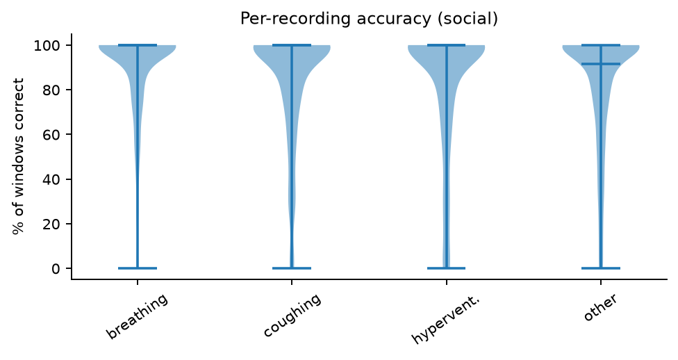

*Per-recording accuracy (social): Share of correctly classified windows within each test recording. Mass near 0 means whole recordings (people) are misread, not single windows.* (vector: `figures/results/recording_accuracy_social.pdf`)

### 6.5 Architecture comparison

| task | model | static % | dynamic % | params | KB | ms/window | balanced % | weakest class % |
|---|---|---|---|---|---|---|---|---|
| har | ★ Multi-branch CNN (ours) | 99.3 | 90.7 | 26112 | 130.8 | 0.026 |  |  |
| har | Spectral-feature net (ours) | 99.4 | 80.9 | 5009 | 44.1 | 0.007 |  |  |
| har | Gravity-split MLP (ours) | 99.3 | 83.0 | 35744 | 165.5 | 0.010 |  |  |
| har | Conv-GRU (ours) | 99.3 | 90.3 | 21152 | 186.3 | 0.053 |  |  |
| har | CNN (Lab 3) | 99.6 | 86.2 | 11538 | 50.4 | 0.011 |  |  |
| har | Logistic regression on statistics (Lab 3) | 99.5 | 72.9 | 319 | 3.1 | 0.155 |  |  |
| har | LSTM (Lab 3) | 99.1 | 79.5 | 4978 | 153.4 | 0.061 |  |  |
| har | MLP (Lab 3) | 99.5 | 75.0 | 12114 | 50.1 | 0.003 |  |  |
| social | Multi-branch CNN (ours) |  |  | 42065 | 223.8 | 0.094 | 82.5 | 77.5 |
| social | Spectral-feature net (ours) |  |  | 3874 | 69.8 | 0.010 | 75.0 | 65.5 |
| social | Gravity-split MLP (ours) |  |  | 57009 | 278.7 | 0.014 | 75.2 | 66.8 |
| social | ★ Conv-GRU (ours) |  |  | 20017 | 288.2 | 0.098 | 82.6 | 78.9 |
| social | CNN (Lab 3) |  |  | 11083 | 48.7 | 0.010 | 57.5 | 39.3 |
| social | Logistic regression on statistics (Lab 3) |  |  | 116 | 2.2 | 0.162 | 47.1 | 12.9 |
| social | LSTM (Lab 3) |  |  | 4747 | 152.5 | 0.062 | 25.7 | 0.0 |
| social | MLP (Lab 3) |  |  | 11883 | 49.3 | 0.003 | 25.0 | 0.0 |

Paired tests (final architecture minus baseline, percentage points, over the 10 folds):

| comparison | metric | mean_diff | folds_a_better | p_wilcoxon |
|---|---|---|---|---|
| har: harry_cnn vs harry_feat (Jan2026 only) | static | -0.08 | 4 | 1.0 |
| har: harry_cnn vs harry_mlp (Jan2026 only) | static | -0.02 | 6 | 0.4609 |
| har: harry_cnn vs harry_rnn (Jan2026 only) | static | -0.01 | 1 | 0.625 |
| har: harry_cnn vs her_cnn (Jan2026 only) | static | -0.29 | 2 | 0.0547 |
| har: harry_cnn vs her_logreg (Jan2026 only) | static | -0.27 | 0 | 0.0312 |
| har: harry_cnn vs her_lstm (Jan2026 only) | static | 0.18 | 6 | 0.3828 |
| har: harry_cnn vs her_mlp (Jan2026 only) | static | -0.25 | 1 | 0.0938 |
| har: harry_cnn vs harry_feat (Jan2026 only) | dynamic | 9.76 | 10 | 0.002 |
| har: harry_cnn vs harry_mlp (Jan2026 only) | dynamic | 7.63 | 10 | 0.002 |
| har: harry_cnn vs harry_rnn (Jan2026 only) | dynamic | 0.4 | 7 | 0.0645 |
| har: harry_cnn vs her_cnn (Jan2026 only) | dynamic | 4.42 | 10 | 0.002 |
| har: harry_cnn vs her_logreg (Jan2026 only) | dynamic | 17.8 | 10 | 0.002 |
| har: harry_cnn vs her_lstm (Jan2026 only) | dynamic | 11.12 | 10 | 0.002 |
| har: harry_cnn vs her_mlp (Jan2026 only) | dynamic | 15.67 | 10 | 0.002 |
| social: harry_rnn vs harry_cnn (Jan2026 only) | social | 0.08 | 6 | 0.8457 |
| social: harry_rnn vs harry_feat (Jan2026 only) | social | 7.62 | 10 | 0.002 |
| social: harry_rnn vs harry_mlp (Jan2026 only) | social | 7.38 | 10 | 0.002 |
| social: harry_rnn vs her_cnn (Jan2026 only) | social | 25.09 | 10 | 0.002 |
| social: harry_rnn vs her_logreg (Jan2026 only) | social | 35.54 | 10 | 0.002 |
| social: harry_rnn vs her_lstm (Jan2026 only) | social | 56.87 | 10 | 0.002 |
| social: harry_rnn vs her_mlp (Jan2026 only) | social | 57.6 | 10 | 0.002 |
| social: harry_rnn vs harry_cnn (Jan2026 only) | social_min | 1.43 | 7 | 0.084 |
| social: harry_rnn vs harry_feat (Jan2026 only) | social_min | 13.44 | 10 | 0.002 |
| social: harry_rnn vs harry_mlp (Jan2026 only) | social_min | 12.13 | 10 | 0.002 |
| social: harry_rnn vs her_cnn (Jan2026 only) | social_min | 39.58 | 10 | 0.002 |
| social: harry_rnn vs her_logreg (Jan2026 only) | social_min | 65.96 | 10 | 0.002 |
| social: harry_rnn vs her_lstm (Jan2026 only) | social_min | 78.89 | 10 | 0.002 |
| social: harry_rnn vs her_mlp (Jan2026 only) | social_min | 78.89 | 10 | 0.002 |

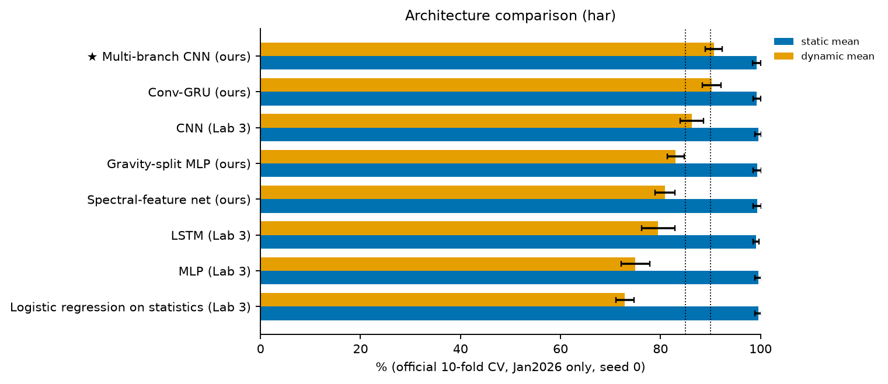

*Architecture comparison (har): Every architecture trained and tested on the same official folds with the same data. ★ = deployed model. Error bars = sd over folds.* (vector: `figures/comparison/architectures_har.pdf`)
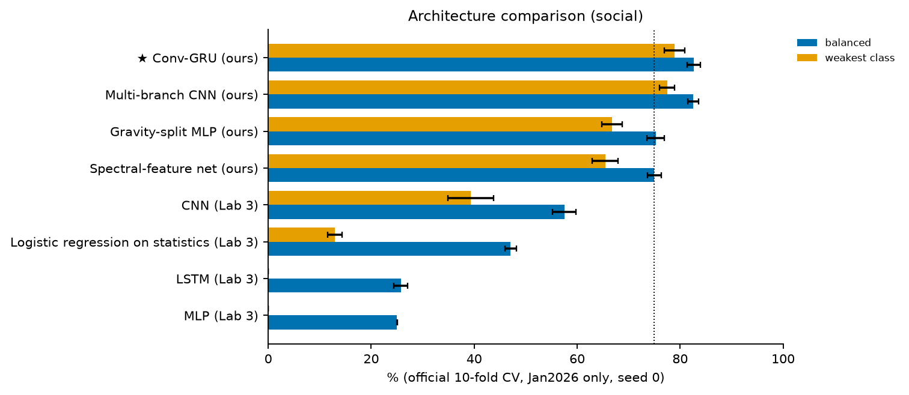

*Architecture comparison (social): Every architecture trained and tested on the same official folds with the same data. ★ = deployed model. Error bars = sd over folds.* (vector: `figures/comparison/architectures_social.pdf`)
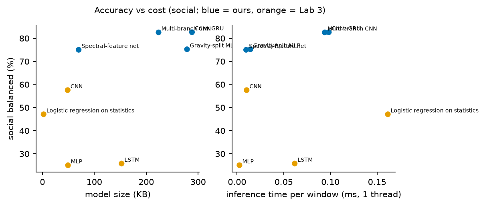

*Accuracy vs model cost (social): Trade-off between accuracy and TFLite size / single-window latency on this Mac (a phone is slower, but the ranking holds).* (vector: `figures/comparison/accuracy_vs_cost_social.pdf`)

### 6.6 Class-weight sweep (social)

| power | normal breathing | coughing | hyperventilation | other | weakest | balanced |
|---|---|---|---|---|---|---|
| 0.0 | 79.1 | 77.3 | 77.1 | 88.7 | 77.1 | 80.6 |
| 0.3 | 83.6 | 79.5 | 79.0 | 85.2 | 79.0 | 81.8 |
| 0.6 | 87.1 | 81.9 | 81.0 | 80.2 | 80.2 | 82.6 |
| 0.8 | 88.4 | 83.8 | 81.3 | 78.2 | 78.2 | 82.9 |
| 1.0 | 90.0 | 85.0 | 82.6 | 74.6 | 74.6 | 83.1 |

Power 0 = no class weights, 1 = fully balanced. Raising the power moves accuracy from *other* to the three minority classes; 0.6 keeps every class above the target with the largest margin for the weakest class. Because the sweep was examined after the choice, report it as a sensitivity analysis rather than as the way the value was picked.

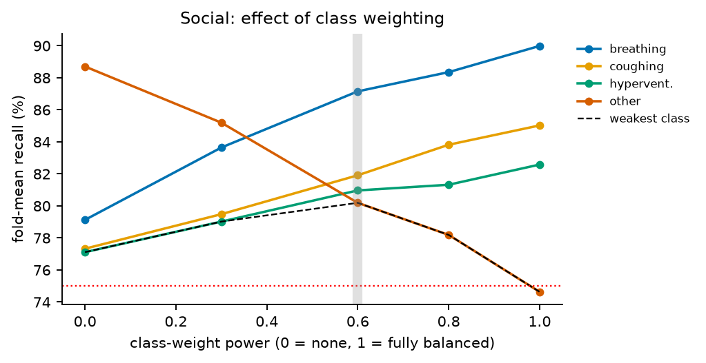

*Class-weight sweep (social): Each class's marked recall as the class weights move from none (0) to fully balanced (1). The grey band is the chosen setting.* (vector: `figures/comparison/class_weight_sweep.pdf`)

### 6.7 Effect of adding the group's recordings

| comparison | metric | mean_a | mean_b | mean_diff | folds_a_better | p_wilcoxon |
|---|---|---|---|---|---|---|
| har: Jan2026 + real data vs Jan2026 only | static | 0.9899 | 0.9928 | -0.29 | 3 | 0.3125 |
| har: Jan2026 + real data vs Jan2026 only | dynamic | 0.8474 | 0.9067 | -5.93 | 0 | 0.002 |
| social: Jan2026 + real data vs Jan2026 only | social | 0.8275 | 0.8262 | 0.14 | 6 | 0.4316 |
| social: Jan2026 + real data vs Jan2026 only | social_min | 0.7854 | 0.7889 | -0.36 | 5 | 1.0 |

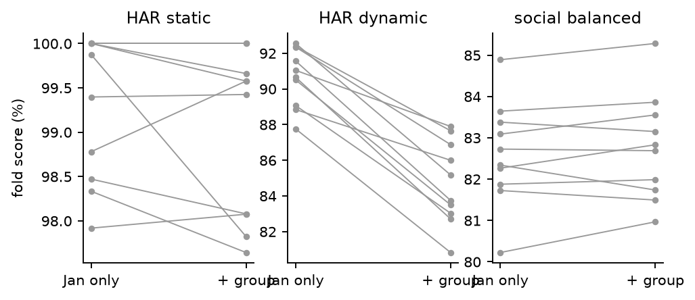

*Effect of adding the group's recordings: Each line is one fold: score with Jan2026 training data only vs with the group members' recordings added (same fold, seed 0).* (vector: `figures/results/variant_paired.pdf`)

### 6.8 Leave-one-person-out (unseen group member)

Balanced accuracy (mean per-class recall) on each member:

| task | tested on | A: Jan2026 only | B: + other member (mixed) | C: + other member (fine-tuned) |
|---|---|---|---|---|
| har | s2503795 | 96.6 | 98.9 | 98.7 |
| har | s2952925 | 96.6 | 98.5 | 97.3 |
| social | s2503795 | 94.4 | 94.8 | 92.8 |
| social | s2952925 | 93.1 | 93.2 | 70.1 |

Social, by posture (balanced accuracy %):

| person | variant | all | lying | sitting/standing |
|---|---|---|---|---|
| s2503795 | A | 94.4 | 96.0 | 91.1 |
| s2503795 | B | 94.8 | 95.7 | 93.0 |
| s2503795 | C | 92.8 | 97.0 | 84.4 |
| s2952925 | A | 93.1 | 94.7 | 91.2 |
| s2952925 | B | 93.2 | 94.9 | 90.9 |
| s2952925 | C | 70.1 | 72.0 | 67.4 |

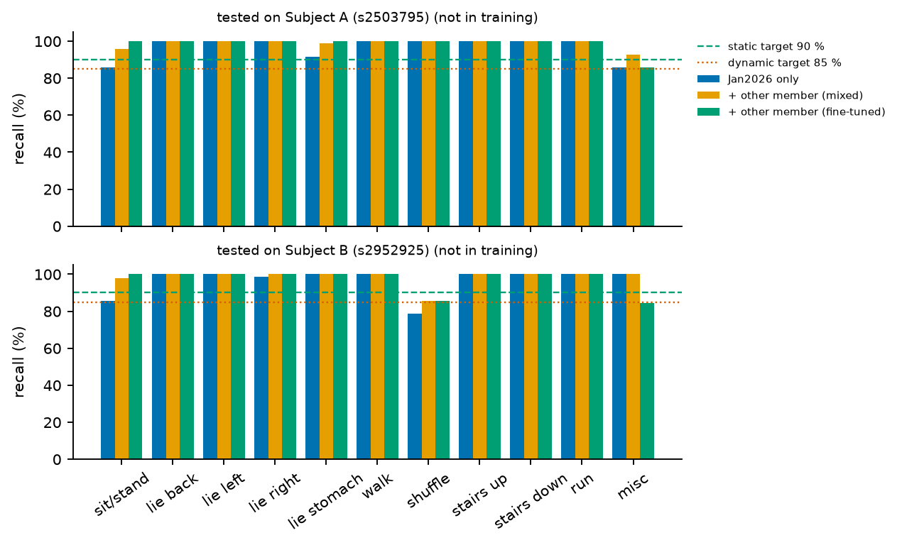

*Leave-one-person-out (har): Each group member tested on models that never saw them: trained on all Jan2026, optionally plus the other member (mixed into training or as a fine-tune).* (vector: `figures/real/lopo_har.pdf`)
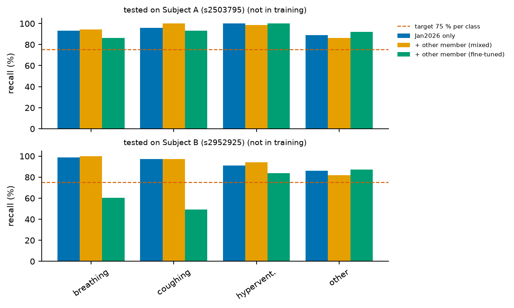

*Leave-one-person-out (social): Each group member tested on models that never saw them: trained on all Jan2026, optionally plus the other member (mixed into training or as a fine-tune).* (vector: `figures/real/lopo_social.pdf`)

### 6.9 Social gate (social only while not moving)

| variant | class | shown % | no gate % | end-to-end % | when shown % |
|---|---|---|---|---|---|
| jan | breathingNormally | 98.5 | 86.8 | 85.8 | 87.1 |
| jan | coughing | 69.0 | 81.9 | 55.6 | 80.5 |
| jan | hyperventilation | 91.4 | 81.0 | 74.4 | 81.4 |
| jan | other | 92.6 | 80.8 | 75.7 | 81.8 |
| jan+real | breathingNormally | 98.7 | 87.5 | 86.5 | 87.6 |
| jan+real | coughing | 92.8 | 82.2 | 76.0 | 81.9 |
| jan+real | hyperventilation | 98.6 | 80.4 | 79.5 | 80.7 |
| jan+real | other | 98.4 | 80.9 | 79.9 | 81.2 |

Moving windows wrongly called stationary (social would run while moving): datasetJan2026 only 0.34 %, datasetJan2026 + group recordings 2.83 %.

The share of coughing windows hidden by the gate is the key number: a datasetJan2026-only activity model has never seen a stationary person coughing (§2.1), so it calls some coughs *miscellaneous movement*. Adding the group recordings, which contain stationary coughing, reduces this. In the app the gate should therefore be tolerant (e.g. only hide social after several consecutive 'moving' results).

On the group members (leave-one-person-out models), share of stationary social windows hidden:

| variant | person | hidden_breathingNormally | hidden_coughing | hidden_hyperventilation | hidden_other |
|---|---|---|---|---|---|
| A | s2503795 | 0.0 | 18.1 | 12.5 | 2.9 |
| A | s2952925 | 0.0 | 14.9 | 17.6 | 1.8 |
| B | s2503795 | 0.0 | 11.1 | 0.0 | 0.0 |
| B | s2952925 | 0.0 | 0.0 | 4.4 | 0.0 |
| C | s2503795 | 0.0 | 0.0 | 0.0 | 0.0 |
| C | s2952925 | 0.0 | 0.0 | 0.0 | 0.0 |

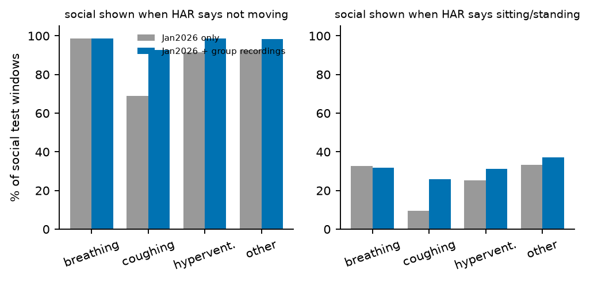

*Social gate: how often social is shown: Share of social test windows (all recorded while stationary) for which the HAR model allows a social result. Below 100 % = social hidden by mistake.* (vector: `figures/real/gate_pass_rate.pdf`)
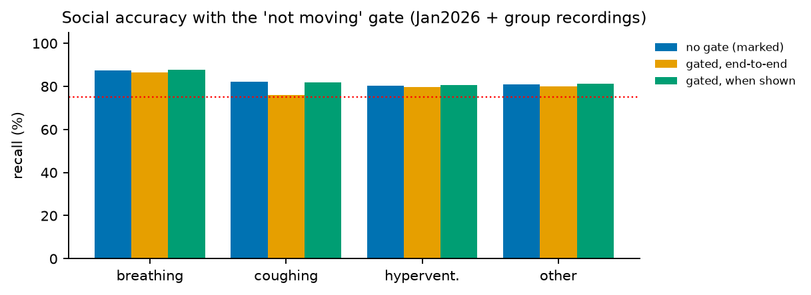

*Effect of the gate on social accuracy: End-to-end = what the user sees (a hidden result counts as wrong); when shown = accuracy of the results that are displayed.* (vector: `figures/real/gate_effect.pdf`)

### 6.10 Simulated real-time accuracy and latency

Share of displayed results that are correct, both members, 5 random session orders:

| task | output | 0.5 s updates | 1 s updates | 2 s updates |
|---|---|---|---|---|
| har | raw | 90.1 | 90.1 | 92.3 |
| har | smoothed | 88.9 | 87.6 | 90.3 |
| social | gated | 73.2 | 73.3 | 74.9 |
| social | raw | 74.6 | 74.8 | 76.0 |

Latency after a change of activity (median over all changes):

| task | output | update interval | median s to first correct | median s to 3 correct in a row |
|---|---|---|---|---|
| har | raw | 0.5 s | 4.0 | 4.0 |
| har | raw | 1 s | 4.24 | 4.24 |
| har | raw | 2 s | 4.0 | 4.0 |
| har | smoothed | 0.5 s | 4.48 | 4.48 |
| har | smoothed | 1 s | 5.2 | 5.2 |
| har | smoothed | 2 s | 4.0 | 4.0 |
| social | gated | 0.5 s | 6.84 | 7.04 |
| social | gated | 1 s | 7.08 | 7.28 |
| social | gated | 2 s | 8.0 | 8.0 |
| social | raw | 0.5 s | 6.56 | 6.8 |
| social | raw | 1 s | 6.96 | 7.28 |
| social | raw | 2 s | 7.76 | 8.0 |

The latency is dominated by the window length (the new activity must fill most of the 4 s / 8 s window), not by computation (milliseconds, §6.11). Shorter update intervals reduce latency by at most one interval.

Trial simulation (each recording from a cold start, 1 s updates):

| task | class | accuracy | first_correct_s |
|---|---|---|---|
| har | ascending stairs | 100.0 | 4.0 |
| har | descending stairs | 100.0 | 4.0 |
| har | lying on back | 100.0 | 4.0 |
| har | lying left | 100.0 | 4.0 |
| har | lying right | 100.0 | 4.0 |
| har | lying on stomach | 100.0 | 4.0 |
| har | miscellaneous movements | 89.2 | 4.0 |
| har | walking | 100.0 | 4.0 |
| har | running | 100.0 | 4.0 |
| har | shuffle walking | 96.4 | 4.0 |
| har | sitting/standing | 100.0 | 4.0 |
| social | normal breathing | 96.7 | 8.3 |
| social | coughing | 97.1 | 8.0 |
| social | hyperventilation | 97.5 | 8.3 |
| social | other | 83.9 | 8.6 |

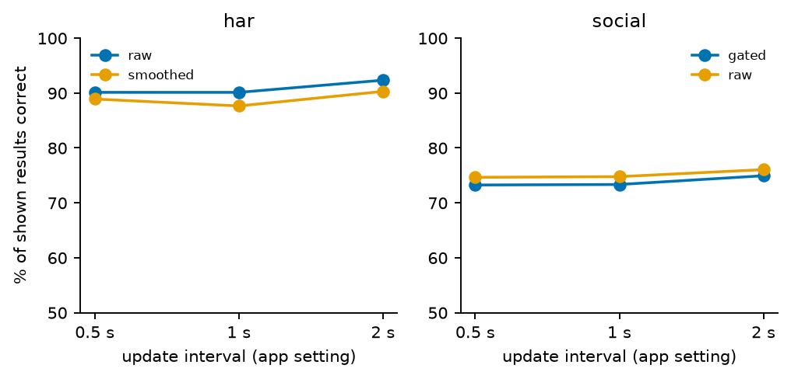

*Simulated app accuracy vs update interval: The group members' recordings streamed back to back through leave-that-person-out models, at every update interval the app offers.* (vector: `figures/real/stream_accuracy_vs_step.pdf`)
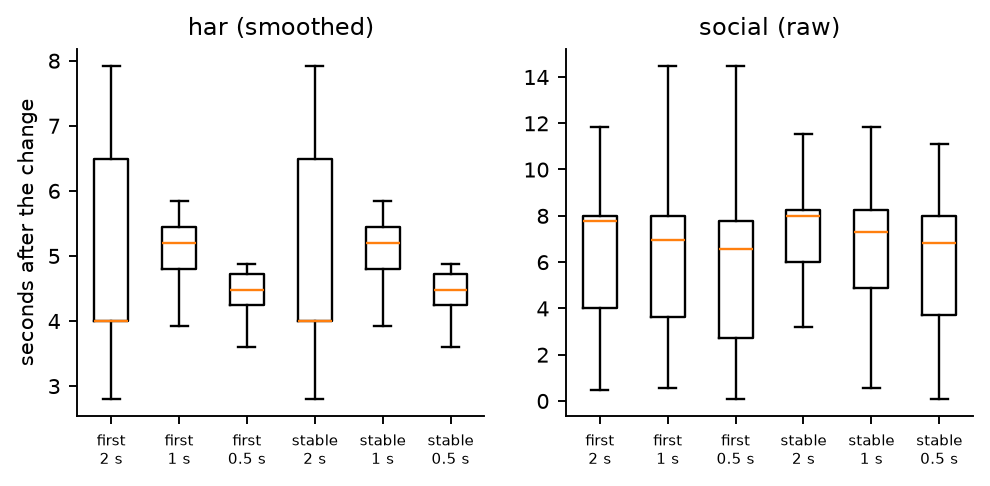

*Detection latency after a change of activity: Time from a change of activity to the first correct result and to three correct results in a row, per update interval (simulation on the group's recordings).* (vector: `figures/real/latency.pdf`)
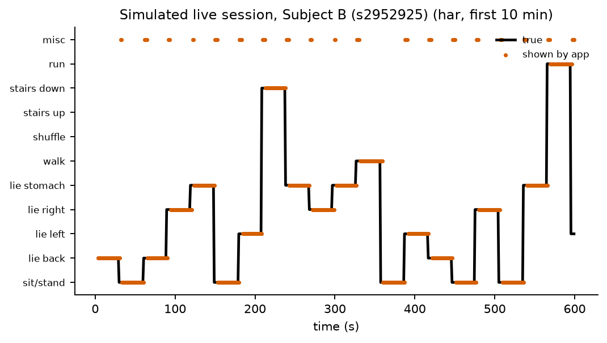

*Simulated session timeline (har, s2952925): Recordings played back to back; black = what the person did, red = what the app would show.* (vector: `figures/real/timeline_har_s2952925.pdf`)

**[fill in] Live real-time test.** Use the app's *Tools → Real-time test* with every group member and every class; report the table of trials, the percentage correct and the time to the first correct result, and compare with the simulation above and with the cross-validation numbers (§7.3).

### 6.11 Deployment cost

| task | model | params | size_kb | ms_per_window | ms_p90 | parity_argmax_agreement | parity_max_abs_dprob |
|---|---|---|---|---|---|---|---|
| har | Multi-branch CNN (ours) | 26112 | 130.7969 | 0.026 | 0.0263 |  |  |
| har | Spectral-feature net (ours) | 5009 | 44.1133 | 0.0068 | 0.007 |  |  |
| har | Gravity-split MLP (ours) | 35744 | 165.4805 | 0.0096 | 0.0098 |  |  |
| har | Conv-GRU (ours) | 21152 | 186.3398 | 0.0526 | 0.0547 |  |  |
| har | CNN (Lab 3) | 11538 | 50.4062 | 0.0108 | 0.011 |  |  |
| har | Logistic regression on statistics (Lab 3) | 319 | 3.0713 | 0.1551 |  |  |  |
| har | LSTM (Lab 3) | 4978 | 153.4141 | 0.061 | 0.0615 |  |  |
| har | MLP (Lab 3) | 12114 | 50.1484 | 0.0026 | 0.0027 |  |  |
| social | Multi-branch CNN (ours) | 42065 | 223.7969 | 0.0939 | 0.0991 |  |  |
| social | Spectral-feature net (ours) | 3874 | 69.8125 | 0.0098 | 0.0102 |  |  |
| social | Gravity-split MLP (ours) | 57009 | 278.6797 | 0.0144 | 0.0147 |  |  |
| social | Conv-GRU (ours) | 20017 | 288.2109 | 0.0984 | 0.1022 |  |  |
| social | CNN (Lab 3) | 11083 | 48.6562 | 0.0103 | 0.0108 |  |  |
| social | Logistic regression on statistics (Lab 3) | 116 | 2.2236 | 0.1615 |  |  |  |
| social | LSTM (Lab 3) | 4747 | 152.5391 | 0.0617 | 0.0664 |  |  |
| social | MLP (Lab 3) | 11883 | 49.2891 | 0.0026 | 0.0028 |  |  |
| har | Multi-branch CNN (ours) – final | 26112 | 133.1 | 0.0264 |  | 1.0 | 0.0 |
| social | Conv-GRU (ours) – final | 20017 | 294.2 | 0.1007 |  | 1.0 | 0.0 |

Times are single-thread TFLite on the development Mac (Apple M1 Pro); a phone is slower but still far below the 0.5 s update interval. Parity = agreement between the Keras model and the exported TFLite file on the group recordings.

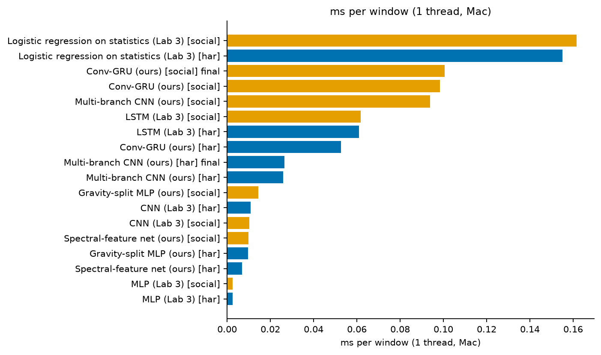

*ms per window (1 thread, Mac): Deployment cost of every architecture (blue = HAR, orange = social).* (vector: `figures/deploy/inference_time.pdf`)
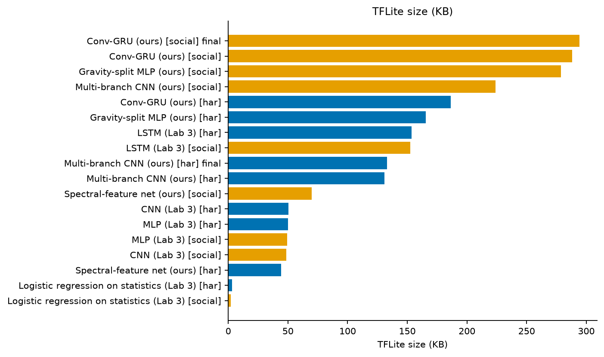

*TFLite size (KB): Deployment cost of every architecture (blue = HAR, orange = social).* (vector: `figures/deploy/model_size.pdf`)

## 7. Critical analysis (material for Results and Discussion)

### 7.1 Why some methods performed better

- **Activities (dynamic mean, Jan2026 only):** ranking Multi-branch CNN (ours) 90.7, Conv-GRU (ours) 90.3, CNN (Lab 3) 86.2, Gravity-split MLP (ours) 83.0, Spectral-feature net (ours) 80.9, LSTM (Lab 3) 79.5, MLP (Lab 3) 75.0, Logistic regression on statistics (Lab 3) 72.9.

- **Social (balanced, Jan2026 only):** ranking Conv-GRU (ours) 82.6, Multi-branch CNN (ours) 82.5, Gravity-split MLP (ours) 75.2, Spectral-feature net (ours) 75.0, CNN (Lab 3) 57.5, Logistic regression on statistics (Lab 3) 47.1, LSTM (Lab 3) 25.7, MLP (Lab 3) 25.0.

- **Separating gravity from motion** is the largest single gain for social signals: breathing moves the chest by a few milli-g, while posture changes gravity by up to 1 g. Normalising the raw signal (Lab 3 models) lets posture dominate the input scale and hides the breathing; the gravity-split models see posture and breathing on separate, individually normalised inputs.
- **Frequency-band features** encode breathing rate and gait cadence directly; they let even the feature-only network compete, and give the deep models a robust summary that does not depend on where in the window an event falls.
- **Longer social window (8 s)** contains whole breaths; 4 s windows (Lab 3 social models) often contain less than one breath.
- **Recurrent vs convolutional for social**: the GRU models the order of inhale/exhale and burst/recovery; compare the two in the table above – if the difference is within the seed spread, say so (the choice then rests on the unseen-person results).
- **Recipe**: augmentation (sensor rotation), label smoothing and class weighting matter as much as architecture for generalising to unseen subjects; Lab 3 models trained with plain Adam and no weighting under-predict minority classes.

### 7.2 Most confused classes and why

- **shuffle walking → sitting/standing**: 10.5 % of shuffle walking windows (239 windows).
- **shuffle walking → miscellaneous movements**: 8.3 % of shuffle walking windows (188 windows) – miscellaneous movements contain small steps, turns and weight shifts that look like slow, irregular shuffling over a 4 s window.
- **miscellaneous movements → shuffle walking**: 8.2 % of miscellaneous movements windows (187 windows) – miscellaneous movements contain small steps, turns and weight shifts that look like slow, irregular shuffling over a 4 s window.
- **descending stairs → shuffle walking**: 7.1 % of descending stairs windows (143 windows) – careful stair descent has short, low-amplitude steps like shuffling.
- **walking → shuffle walking**: 6.7 % of walking windows (155 windows) – both are level walking at a similar cadence; shuffling only shortens the stride and lowers the vertical bounce, so a chest sensor sees a scaled-down version of the same rhythm.
- **ascending stairs → walking**: 5.3 % of ascending stairs windows (121 windows) – stair climbing is walking with an extra vertical component that is small at chest level.

- **coughing → other**: 12.3 % of coughing windows (1420 windows) – laughing and some eating movements produce short abdominal bursts that resemble coughs.
- **normal breathing → other**: 10.9 % of normal breathing windows (1374 windows) – talking, eating, singing and laughing are intermittent: an 8 s window often contains pauses that are just normal breathing, and the vocal vibrations are small at 12.5 Hz.
- **hyperventilation → other**: 9.9 % of hyperventilation windows (1206 windows) – singing and laughing involve deep, fast breaths like hyperventilation.
- **other → normal breathing**: 9.5 % of other windows (3817 windows) – talking, eating, singing and laughing are intermittent: an 8 s window often contains pauses that are just normal breathing, and the vocal vibrations are small at 12.5 Hz.
- **other → coughing**: 6.0 % of other windows (2418 windows) – laughing and some eating movements produce short abdominal bursts that resemble coughs.
- **hyperventilation → coughing**: 5.5 % of hyperventilation windows (667 windows) – both produce strong, fast chest movements; a run of coughs and forced rapid breathing overlap in amplitude and rate.

### 7.3 Cross-validation vs real time

Expected differences, to discuss against your live test: (1) CV scores single windows from fully settled recordings, whereas live use includes transitions, where the first 2–4 s after a change are necessarily wrong (latency, §6.10); (2) CV test subjects come from the same recording campaign as the training data, while live users wear the sensor slightly differently (the gravity check, §2.2); (3) the app smooths activity results and gates social results, which raises displayed accuracy for steady activities but delays changes; (4) live trials are few, so their percentages have wide confidence intervals (a 10-trial test has a ±30-point 95 % interval at 50 %).

### 7.4 Limitations

- Fold-level spread shows that some groups of subjects are much harder than others; the mean hides this (§6.1 heatmaps).
- Only two group members provide real-world data; leave-one-person-out with two people is indicative, not conclusive.
- datasetJan2026 has no stationary activity data with social signals, so a Jan-only activity model misreads coughs as movement.
- Hyper-parameters (epochs, learning rate, window lengths) were fixed from earlier experiments on different folds; the class-weight power was chosen after seeing results from the official folds (sensitivity analysis provided).
- Windows from one recording are correlated, so window-level confidence intervals would be too narrow; fold-level statistics are used.
- Accelerometer only, 12.5 Hz: voice and fine cough acoustics are not observable; talking and singing are recognised through breathing pattern changes only.

### 7.5 Improvements / future work

- More real users (especially female and male participants with different body shapes) recorded with the deployed app.
- Stationary-with-social-signal recordings added to the activity training data for every subject (fixes the cough gate problem).
- Ensembling the CNN and GRU social models, or test-time averaging over consecutive windows.
- Nested cross-validation for hyper-parameters; per-user calibration (a short personal fine-tune in the app).
- Quantisation (int8) to cut model size and power further.

## 8. Testing and verification of the models

- **Keras ↔ TFLite parity**: every exported model is run on all group recordings in both forms; argmax agreement and the largest probability difference are recorded (§6.11).
- **App parity check**: each model ships with an `_example.json` (one input window and the expected probabilities); a debug build of the app runs it at start-up and prints both results.
- **Data checks**: duplicate detection, fold-coverage check, sampling-rate and placement checks (§2).
- **Leakage controls**: per-fold normalisation fitted on training windows only; fixed epochs; gate models retrained without copies of the social test recordings; unlisted recordings kept out of CV.
- **Reproducibility**: fixed seeds, every job's settings and per-epoch history stored; the pipeline resumes and regenerates every table, figure and this document.
- **App unit tests** (Flutter) cover the classifiers' window handling, metadata validation and the history store.

## 9. Where everything is

| what | where |
|---|---|
| deployable models | `final_run/final_models/` (copy into the app's `assets/models/`, see INSTALL.md) |
| every figure (PNG + PDF) | `final_run/figures/<section>/` and the gallery `final_run/index.html` |
| every number | `final_run/tables/*.csv` (described below) |
| per-job raw outputs | `final_run/jobs/<id>.json` (settings, per-epoch history, timing), `<id>.npz` (test probabilities, labels, recording ids), `<id>.log`, `jobs/models/*.keras` |
| run log | `final_run/run.log` |

| table | one row per | use it for |
|---|---|---|
| jobs_index.csv | job | what ran, settings, time, parameters |
| per_fold_class.csv | job × class | recall/precision/F1 per fold – recompute any marked number |
| fold_scores.csv | job (fold) | group scores and other metrics per fold |
| summary_per_class.csv | experiment × class | fold mean (marked), fold/seed sd, CI, min/max |
| summary_scores.csv | experiment | group scores mean and sd over seeds |
| confusion_long.csv | job × true × predicted | any confusion matrix (sum over folds / seeds) |
| epochs.csv | job × epoch | learning curves (train and held-out loss/accuracy/score) |
| recording_level.csv | test recording | per-recording accuracy, vote, confidence |
| calibration_bins.csv | job × confidence bin | reliability diagrams |
| stat_tests.csv | comparison | paired Wilcoxon tests |
| gate_folds.csv / gate_leaks.csv | fold × class | social gate analysis |
| lopo_per_class.csv / lopo_scores.csv / lopo_gate.csv | person × variant × class | unseen-person results |
| stream_accuracy.csv / stream_latency.csv / stream_timeline.csv / trial_simulation.csv | session × step / change / result | simulated real-time accuracy and latency |
| deploy.csv | architecture | size, parameters, latency, parity |
| data_composition.csv / fold_composition.csv / duplicates_har_social.csv / real_data_quality.csv / jan_gravity.csv | class / recording | data section |
| tsne.csv | window | embedding scatter |
| timing.csv | job group | compute cost |

## 10. Figure catalogue

**data**

- `figures/data/recordings_per_class_har.png` – datasetJan2026 daily activity recordings per class: Number of recordings per class. Grey: files present on disk but not listed in the official fold CSV (unknown subjects; excluded from CV, used only to train the final models).
- `figures/data/minutes_per_class_har.png` – Total recorded time per class (har): Total duration of accelerometer data per class (all Jan2026 files).
- `figures/data/recordings_per_class_social.png` – datasetJan2026 social signal recordings per class: Number of recordings per class. Grey: files present on disk but not listed in the official fold CSV (unknown subjects; excluded from CV, used only to train the final models).
- `figures/data/minutes_per_class_social.png` – Total recorded time per class (social): Total duration of accelerometer data per class (all Jan2026 files).
- `figures/data/recording_lengths.png` – Recording lengths: Distribution of recording length; the dashed line is the model input window (4 s HAR, 8 s social). Every recording is longer than the window, so none is dropped.
- `figures/data/fold_composition_har.png` – Official fold composition (har): Recordings per class in each official fold: the folds are balanced per class, as the marking scheme describes.
- `figures/data/fold_composition_social.png` – Official fold composition (social): Recordings per class in each official fold: the folds are balanced per class, as the marking scheme describes.
- `figures/data/example_signals_har.png` – Example raw signals (har): First 20 s of one recording per class (x, y, z in g). Posture shows up as the constant offset (gravity), activity as the oscillation around it.
- `figures/data/example_signals_social.png` – Example raw signals (social): First 20 s of one recording per class (x, y, z in g). Posture shows up as the constant offset (gravity), activity as the oscillation around it.
- `figures/data/gravity_orientation.png` – Gravity orientation per posture: Mean acceleration of each static recording (= gravity direction = posture). Group members' recordings (large markers) fall inside the Jan2026 clusters, so sensor placement matches the dataset.
- `figures/data/real_data_quality.png` – Group recordings: quality checks: Per recording of each group member: angle between its gravity vector and the Jan2026 mean for the same class (placement check) and the sampling rate estimated from timestamps (nominal 12.5 Hz).
- `figures/data/spectra_har.png` – Mean spectrum of the acceleration magnitude (har): Welch power spectrum of the gravity-free acceleration magnitude, averaged over up to 200 recordings per class. These frequency bands motivate the in-model band-power features.
- `figures/data/intensity_har.png` – Movement intensity per class (har): How much the signal varies around gravity in each class (log scale). Static and social classes differ by orders of magnitude from dynamic ones.
- `figures/data/spectra_social.png` – Mean spectrum of the acceleration magnitude (social): Welch power spectrum of the gravity-free acceleration magnitude, averaged over up to 200 recordings per class. These frequency bands motivate the in-model band-power features.
- `figures/data/intensity_social.png` – Movement intensity per class (social): How much the signal varies around gravity in each class (log scale). Static and social classes differ by orders of magnitude from dynamic ones.
- `figures/data/duplicates.png` – Static HAR recordings that are byte-copies of social recordings: Every static daily-activity file is a copy of a social-signal recording (breathing). The two official fold CSVs mostly place the copies in different folds.

**training**

- `figures/training/learning_curves_har_jan.png` – Learning curves (har, Jan2026 only): Training and held-out-fold loss/accuracy per epoch, mean ± sd over the 10 official folds. The test fold was only monitored, never used to stop or tune training (fixed epochs, as in Lab 3).
- `figures/training/learning_curves_har_jan_real.png` – Learning curves (har, Jan2026 + group recordings): Training and held-out-fold loss/accuracy per epoch, mean ± sd over the 10 official folds. The test fold was only monitored, never used to stop or tune training (fixed epochs, as in Lab 3).
- `figures/training/learning_curves_all_models_har.png` – Held-out score per epoch, every architecture (har, Jan2026 only): Mean held-out score (static/dynamic mean for HAR, balanced accuracy for social) over the 10 folds after each epoch.
- `figures/training/learning_curves_social_jan.png` – Learning curves (social, Jan2026 only): Training and held-out-fold loss/accuracy per epoch, mean ± sd over the 10 official folds. The test fold was only monitored, never used to stop or tune training (fixed epochs, as in Lab 3).
- `figures/training/learning_curves_social_jan_real.png` – Learning curves (social, Jan2026 + group recordings): Training and held-out-fold loss/accuracy per epoch, mean ± sd over the 10 official folds. The test fold was only monitored, never used to stop or tune training (fixed epochs, as in Lab 3).
- `figures/training/learning_curves_all_models_social.png` – Held-out score per epoch, every architecture (social, Jan2026 only): Mean held-out score (static/dynamic mean for HAR, balanced accuracy for social) over the 10 folds after each epoch.
- `figures/training/training_time.png` – Training cost per fold: Wall-clock time per fold job on an Apple M1 Pro (2 threads per job, 4 jobs in parallel).

**results**

- `figures/results/per_class_har.png` – Per-class accuracy, official 10-fold CV (har): Mean over the 10 official folds of each class's recall (the marked number), error bars = sd over folds. Both training-data variants shown.
- `figures/results/group_scores_har.png` – Group scores (har): Marked group scores (mean over folds and seeds); error bars = sd over folds.
- `figures/results/fold_heatmap_har_jan.png` – Recall per class and fold (har, Jan2026 only, seed 0): Every fold's recall per class: shows which folds (groups of subjects) are hard.
- `figures/results/fold_heatmap_har_jan_real.png` – Recall per class and fold (har, Jan2026 + group recordings, seed 0): Every fold's recall per class: shows which folds (groups of subjects) are hard.
- `figures/results/fold_spread_har.png` – Spread over folds and seeds (har, Jan2026 + group recordings): Each dot is one fold of one seed; boxes show the median and quartiles.
- `figures/results/seed_variation_har.png` – Run-to-run variation across training seeds (har): The marked number for each of the 3 training seeds: the spread shows how much of a difference between models could be chance.
- `figures/results/precision_recall_f1_har.png` – Recall, precision and F1 per class (har): Recall is what the marking uses; precision shows how often a predicted class is right, which matters to an app user.
- `figures/results/per_class_social.png` – Per-class accuracy, official 10-fold CV (social): Mean over the 10 official folds of each class's recall (the marked number), error bars = sd over folds. Both training-data variants shown.
- `figures/results/group_scores_social.png` – Group scores (social): Marked group scores (mean over folds and seeds); error bars = sd over folds.
- `figures/results/fold_heatmap_social_jan.png` – Recall per class and fold (social, Jan2026 only, seed 0): Every fold's recall per class: shows which folds (groups of subjects) are hard.
- `figures/results/fold_heatmap_social_jan_real.png` – Recall per class and fold (social, Jan2026 + group recordings, seed 0): Every fold's recall per class: shows which folds (groups of subjects) are hard.
- `figures/results/fold_spread_social.png` – Spread over folds and seeds (social, Jan2026 + group recordings): Each dot is one fold of one seed; boxes show the median and quartiles.
- `figures/results/seed_variation_social.png` – Run-to-run variation across training seeds (social): The marked number for each of the 3 training seeds: the spread shows how much of a difference between models could be chance.
- `figures/results/precision_recall_f1_social.png` – Recall, precision and F1 per class (social): Recall is what the marking uses; precision shows how often a predicted class is right, which matters to an app user.
- `figures/results/confusion_har_jan_pct.png` – Confusion matrix, har, Jan2026 only (row %): All test windows of the 10 folds pooled (seed 0). Rows = true class; the diagonal is the recall.
- `figures/results/confusion_har_jan_counts.png` – Confusion matrix, har, Jan2026 only (counts): All test windows of the 10 folds pooled (seed 0). Rows = true class; the diagonal is the recall.
- `figures/results/confusion_har_jan_real_pct.png` – Confusion matrix, har, Jan2026 + group recordings (row %): All test windows of the 10 folds pooled (seed 0). Rows = true class; the diagonal is the recall.
- `figures/results/confusion_har_jan_real_counts.png` – Confusion matrix, har, Jan2026 + group recordings (counts): All test windows of the 10 folds pooled (seed 0). Rows = true class; the diagonal is the recall.
- `figures/results/confusion_social_jan_pct.png` – Confusion matrix, social, Jan2026 only (row %): All test windows of the 10 folds pooled (seed 0). Rows = true class; the diagonal is the recall.
- `figures/results/confusion_social_jan_counts.png` – Confusion matrix, social, Jan2026 only (counts): All test windows of the 10 folds pooled (seed 0). Rows = true class; the diagonal is the recall.
- `figures/results/confusion_social_jan_real_pct.png` – Confusion matrix, social, Jan2026 + group recordings (row %): All test windows of the 10 folds pooled (seed 0). Rows = true class; the diagonal is the recall.
- `figures/results/confusion_social_jan_real_counts.png` – Confusion matrix, social, Jan2026 + group recordings (counts): All test windows of the 10 folds pooled (seed 0). Rows = true class; the diagonal is the recall.
- `figures/results/confusion_social_per_fold.png` – Social confusion per fold: Row-normalised confusion matrix of every fold.
- `figures/results/recording_accuracy_har.png` – Per-recording accuracy (har): Share of correctly classified windows within each test recording. Mass near 0 means whole recordings (people) are misread, not single windows.
- `figures/results/recording_accuracy_social.png` – Per-recording accuracy (social): Share of correctly classified windows within each test recording. Mass near 0 means whole recordings (people) are misread, not single windows.
- `figures/results/calibration.png` – Reliability diagram: Accuracy of test windows grouped by the model's confidence. On the diagonal = confidence can be trusted (e.g. for showing a confidence value in the app).
- `figures/results/roc_pr_har.png` – ROC and PR curves (har): Per-class ROC (with AUC) and precision–recall curves of the headline models, all test windows pooled.
- `figures/results/roc_pr_social.png` – ROC and PR curves (social): Per-class ROC (with AUC) and precision–recall curves of the headline models, all test windows pooled.
- `figures/results/tsne_har.png` – t-SNE embedding (har): Penultimate-layer activations of held-out windows, projected to 2-D. Overlapping clusters are the classes the model confuses.
- `figures/results/tsne_social.png` – t-SNE embedding (social): Penultimate-layer activations of held-out windows, projected to 2-D. Overlapping clusters are the classes the model confuses.
- `figures/results/variant_paired.png` – Effect of adding the group's recordings: Each line is one fold: score with Jan2026 training data only vs with the group members' recordings added (same fold, seed 0).

**comparison**

- `figures/comparison/architectures_har.png` – Architecture comparison (har): Every architecture trained and tested on the same official folds with the same data. ★ = deployed model. Error bars = sd over folds.
- `figures/comparison/architectures_per_class_har.png` – Per-class recall of every architecture (har): Which classes each architecture gets right; the weak classes are shared by all models, i.e. they are hard in the data, not only for one model.
- `figures/comparison/accuracy_vs_cost_har.png` – Accuracy vs model cost (har): Trade-off between accuracy and TFLite size / single-window latency on this Mac (a phone is slower, but the ranking holds).
- `figures/comparison/architectures_social.png` – Architecture comparison (social): Every architecture trained and tested on the same official folds with the same data. ★ = deployed model. Error bars = sd over folds.
- `figures/comparison/architectures_per_class_social.png` – Per-class recall of every architecture (social): Which classes each architecture gets right; the weak classes are shared by all models, i.e. they are hard in the data, not only for one model.
- `figures/comparison/accuracy_vs_cost_social.png` – Accuracy vs model cost (social): Trade-off between accuracy and TFLite size / single-window latency on this Mac (a phone is slower, but the ranking holds).
- `figures/comparison/class_weight_sweep.png` – Class-weight sweep (social): Each class's marked recall as the class weights move from none (0) to fully balanced (1). The grey band is the chosen setting.
- `figures/comparison/paired_tests.png` – Paired statistical comparisons: Differences between models / settings on the same folds with Wilcoxon signed-rank p-values (10 folds = small sample, so p ≥ 0.002 is the smallest possible).

**deploy**

- `figures/deploy/model_size.png` – TFLite size (KB): Deployment cost of every architecture (blue = HAR, orange = social).
- `figures/deploy/inference_time.png` – ms per window (1 thread, Mac): Deployment cost of every architecture (blue = HAR, orange = social).
- `figures/deploy/parameters.png` – parameters: Deployment cost of every architecture (blue = HAR, orange = social).

**real**

- `figures/real/gate_pass_rate.png` – Social gate: how often social is shown: Share of social test windows (all recorded while stationary) for which the HAR model allows a social result. Below 100 % = social hidden by mistake.
- `figures/real/gate_effect.png` – Effect of the gate on social accuracy: End-to-end = what the user sees (a hidden result counts as wrong); when shown = accuracy of the results that are displayed.
- `figures/real/gate_leaks.png` – Social wrongly enabled while moving: Share of dynamic-activity test windows classified as a static class.
- `figures/real/lopo_har.png` – Leave-one-person-out (har): Each group member tested on models that never saw them: trained on all Jan2026, optionally plus the other member (mixed into training or as a fine-tune).
- `figures/real/lopo_social.png` – Leave-one-person-out (social): Each group member tested on models that never saw them: trained on all Jan2026, optionally plus the other member (mixed into training or as a fine-tune).
- `figures/real/lopo_social_postures.png` – Social accuracy by posture (LOPO): Sitting/standing is the posture the professor asked social to work in; lying is shown for completeness.
- `figures/real/stream_accuracy_vs_step.png` – Simulated app accuracy vs update interval: The group members' recordings streamed back to back through leave-that-person-out models, at every update interval the app offers.
- `figures/real/latency.png` – Detection latency after a change of activity: Time from a change of activity to the first correct result and to three correct results in a row, per update interval (simulation on the group's recordings).
- `figures/real/latency_per_class.png` – Latency per activity: Median time from a change to the first correct result, by the activity changed to.
- `figures/real/timeline_har_s2503795.png` – Simulated session timeline (har, s2503795): Recordings played back to back; black = what the person did, red = what the app would show.
- `figures/real/timeline_har_s2952925.png` – Simulated session timeline (har, s2952925): Recordings played back to back; black = what the person did, red = what the app would show.
- `figures/real/timeline_social_s2503795.png` – Simulated session timeline (social, s2503795): Recordings played back to back; black = what the person did, red = what the app would show.
- `figures/real/timeline_social_s2952925.png` – Simulated session timeline (social, s2952925): Recordings played back to back; black = what the person did, red = what the app would show.
- `figures/real/trial_simulation.png` – Simulated real-time test: Each recording replayed from a cold start, like a trial in the app's real-time test: bars = share of results correct, dots = time to the first correct result (includes filling the window).

## 11. References (check details before citing)

1. University of Edinburgh, PDIoT Coursework 3 Instructions, 2026.
2. D. K. Arvind and colleagues: RESpeck respiratory monitoring – e.g. A. Bates, M. J. Ling, J. Mann, D. K. Arvind, "Respiratory rate and flow waveform estimation from tri-axial accelerometer data", Body Sensor Networks (BSN), 2010.
3. A. Bulling, U. Blanke, B. Schiele, "A tutorial on human activity recognition using body-worn inertial sensors", ACM Computing Surveys 46(3), 2014.
4. F. J. Ordóñez, D. Roggen, "Deep convolutional and LSTM recurrent neural networks for multimodal wearable activity recognition", Sensors 16(1), 2016.
5. N. Y. Hammerla, S. Halloran, T. Plötz, "Deep, convolutional, and recurrent models for human activity recognition using wearables", IJCAI, 2016.
6. J. Wang, Y. Chen, S. Hao, X. Peng, L. Hu, "Deep learning for sensor-based activity recognition: a survey", Pattern Recognition Letters 119, 2019.
7. D. M. Karantonis et al., "Implementation of a real-time human movement classifier using a triaxial accelerometer for ambulatory monitoring", IEEE T-ITB 10(1), 2006.
8. T. T. Um et al., "Data augmentation of wearable sensor data for Parkinson's disease monitoring using convolutional neural networks", ICMI, 2017.
9. F. Yu, V. Koltun, "Multi-scale context aggregation by dilated convolutions", ICLR, 2016.
10. S. Ioffe, C. Szegedy, "Batch normalization", ICML, 2015.
11. N. Srivastava et al., "Dropout: a simple way to prevent neural networks from overfitting", JMLR 15, 2014.
12. K. Cho et al., "Learning phrase representations using RNN encoder–decoder for statistical machine translation" (GRU), EMNLP, 2014.
13. S. Hochreiter, J. Schmidhuber, "Long short-term memory", Neural Computation 9(8), 1997.
14. I. Loshchilov, F. Hutter, "Decoupled weight decay regularization" (AdamW), ICLR, 2019; "SGDR: stochastic gradient descent with warm restarts", ICLR, 2017.
15. C. Szegedy et al., "Rethinking the Inception architecture for computer vision" (label smoothing), CVPR, 2016.
16. Y. Cui, M. Jia, T.-Y. Lin, Y. Song, S. Belongie, "Class-balanced loss based on effective number of samples", CVPR, 2019.
17. C. Guo, G. Pleiss, Y. Sun, K. Q. Weinberger, "On calibration of modern neural networks", ICML, 2017.
18. L. van der Maaten, G. Hinton, "Visualizing data using t-SNE", JMLR 9, 2008.
19. F. Wilcoxon, "Individual comparisons by ranking methods", Biometrics Bulletin 1(6), 1945; J. Demšar, "Statistical comparisons of classifiers over multiple data sets", JMLR 7, 2006.
20. P. D. Welch, "The use of fast Fourier transform for the estimation of power spectra", IEEE T-AU 15(2), 1967.
21. TensorFlow Lite / LiteRT documentation, Google, 2026.
