# Activity and social-signal models: data, method and results (v2)

_Generated 2026-11-10 03:20 by `model_harry/run_pipeline_v2.py` from the tables in `results/tables/`. Every number below is computed, not typed; re-running the pipeline regenerates this file. Figures: `results/figures/` (PNG to view, PDF for the report); all of them with captions: `results/index.html`. For the whole project in one place (data use, decisions and their reasons, history, a question → file map) start with `results/KNOWLEDGE.md`._

> **How to use this document.** It is longer than the 4,000-word report allows. Each section maps to a part of the report (Methodology → activity recognition / social signals / testing; Results and Discussion → model accuracy / critical analysis). Sections marked **[fill in]** need results only the live test on the phone can give.

## 0. Design decisions in this run

- **Models:** only our four architectures are trained – Multi-branch CNN, Conv-GRU, Gravity-split MLP, Spectral-feature net. Deployed: **Multi-branch CNN** for activities, **Conv-GRU** for social signals.
- **Data:** one way of using it. datasetJan2026 and both group members' recordings are mixed in training, and the two members take part in the folds as two extra subjects (Subject A (s2503795) → fold 8, Subject B (s2952925) → fold 9): a member is in the test set of exactly one fold and in the training set of the other nine. Activities: mixed as well.
- **Scoring:** every fold is scored on all its test windows (**headline**) and on its datasetJan2026 windows only, which is exactly the number the CW3 marking computes with the official fold files.
- **Social window:** 6 s (candidate `w75`): the fastest of the measured candidates whose every class keeps ≥ 77 % (§6.6).

- **Activity check:** with the group members mixed into training, the datasetJan2026 dynamic mean was 90.5 % (rule: ≥ 85 %) → **mixed**.

## 1. Headline results (subject-wise 10-fold cross-validation)

Recall of each class on the held-out fold, averaged over the 10 folds; group means as in the CW3 brief. Values: mean over 3 training seeds; ± = standard deviation over the 10 folds (seed 0). **All test windows** includes the group member assigned to a fold; **as marked** uses only that fold's datasetJan2026 windows.

| task | class | all test windows | as marked (Jan2026 windows) | target | pass (marked) |
|---|---|---|---|---|---|
| activity | sitting/standing | 97.5 ± 3.7 | 97.4 ± 4.2 | (static ≥ 90 % mean) |  |
| activity | lying on back | 99.7 ± 0.0 | 99.7 ± 0.0 | (static ≥ 90 % mean) |  |
| activity | lying left | 100.0 ± 0.0 | 100.0 ± 0.0 | (static ≥ 90 % mean) |  |
| activity | lying right | 100.0 ± 0.0 | 100.0 ± 0.0 | (static ≥ 90 % mean) |  |
| activity | lying on stomach | 99.7 ± 1.0 | 99.7 ± 1.0 | (static ≥ 90 % mean) |  |
| activity | walking | 89.8 ± 5.9 | 89.7 ± 5.9 | (dynamic ≥ 85 % mean) |  |
| activity | shuffle walking | 88.0 ± 7.2 | 88.0 ± 7.2 | (dynamic ≥ 85 % mean) |  |
| activity | ascending stairs | 93.8 ± 4.4 | 93.8 ± 4.4 | (dynamic ≥ 85 % mean) |  |
| activity | descending stairs | 92.8 ± 4.0 | 92.7 ± 4.2 | (dynamic ≥ 85 % mean) |  |
| activity | running | 96.9 ± 2.2 | 96.9 ± 2.2 | (dynamic ≥ 85 % mean) |  |
| activity | miscellaneous movements | 82.8 ± 3.8 | 82.7 ± 3.7 | (dynamic ≥ 85 % mean) |  |
| social | normal breathing | 86.4 ± 3.1 | 86.4 ± 3.0 | ≥ 75 % | ✓ |
| social | coughing | 82.3 ± 3.7 | 82.1 ± 4.0 | ≥ 75 % | ✓ |
| social | hyperventilation | 80.2 ± 1.9 | 80.0 ± 1.9 | ≥ 75 % | ✓ |
| social | other | 78.3 ± 1.8 | 78.2 ± 1.8 | ≥ 75 % | ✓ |
| activity | **static mean (5 classes)** | **99.4** ± 0.7 | **99.4** ± 0.8 | ≥ 90 % | ✓ |
| activity | **dynamic mean (6 classes)** | **90.7** ± 2.0 | **90.6** ± 1.9 | ≥ 85 % | ✓ |
| social | **social balanced (4 classes)** | **81.8** ± 1.4 | **81.7** ± 1.5 | ≥ 75 % | ✓ |
| social | **weakest social class** | **77.5** ± 1.5 | **77.4** ± 1.6 | ≥ 75 % | ✓ |

Seed-to-seed standard deviation of the group scores (all windows): static 0.08, dynamic 0.19, social 0.06 percentage points – differences smaller than about twice these are run-to-run noise.

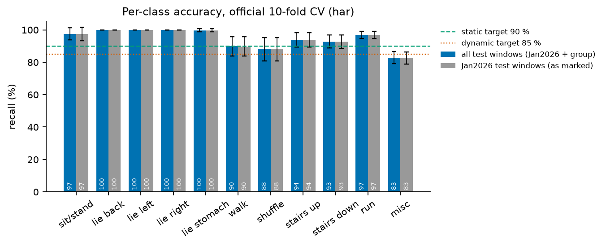

*Per-class accuracy, official 10-fold CV (har): Mean over the 10 official folds of each class's recall (the marked number), error bars = sd over folds. Blue: every test window of each fold (datasetJan2026 + the group member in that fold); grey: the datasetJan2026 windows only, i.e. what the CW3 marking computes.* (vector: `figures/results/per_class_har.pdf`)

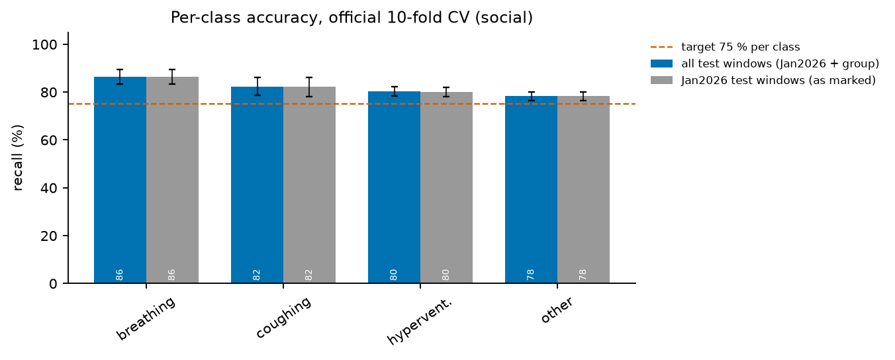

*Per-class accuracy, official 10-fold CV (social): Mean over the 10 official folds of each class's recall (the marked number), error bars = sd over folds. Blue: every test window of each fold (datasetJan2026 + the group member in that fold); grey: the datasetJan2026 windows only, i.e. what the CW3 marking computes.* (vector: `figures/results/per_class_social.pdf`)

## 2. Data

### 2.1 datasetJan2026 (the provided dataset)

RESpeck chest-worn tri-axial accelerometer, 12.5 Hz, values in g. Two parts:

- **Daily activity** (11 classes): 1869 recordings (15.77 h) listed in the official fold file, plus 50 files on disk that the fold file does not list.
- **Social signals** (4 classes): 6440 listed recordings (54.24 h), plus 52 unlisted files.

| task | class | recordings | mean length (s) | shortest (s) |
|---|---|---|---|---|
| har | ascending stairs | 163 | 30.3 | 28.0 |
| har | descending stairs | 146 | 30.2 | 28.2 |
| har | lying on back | 155 | 30.3 | 28.0 |
| har | lying left | 117 | 30.3 | 26.3 |
| har | lying right | 113 | 30.2 | 28.0 |
| har | lying on stomach | 172 | 30.3 | 28.0 |
| har | miscellaneous movements | 163 | 30.3 | 28.0 |
| har | walking | 166 | 30.3 | 28.0 |
| har | running | 168 | 30.2 | 25.2 |
| har | shuffle walking | 164 | 30.3 | 28.0 |
| har | sitting/standing | 342 | 30.8 | 28.0 |
| social | normal breathing | 1047 | 30.6 | 26.3 |
| social | coughing | 977 | 30.2 | 25.8 |
| social | hyperventilation | 1024 | 30.3 | 20.4 |
| social | other | 3392 | 30.3 | 26.7 |

Sitting and standing are one class (as required); talking, eating, singing and laughing form the single social class *other*. Classes are imbalanced: *other* holds about half of the social data, which drives the class-weighting choice (§4.2).

**Official folds.** `folds_daily_activity.csv` and `folds_social_signal.csv` assign every listed recording to one of 10 folds, per activity (subject IDs are not shared across activities). Every fold contains every class.

**Unlisted recordings.** 102 recordings on disk are not in the fold files and are not copies of listed files, so their subjects' folds are unknown. Putting them in any fold could place a test subject in training, so they are **left out of cross-validation** and used only to train the final deployed models.

**Duplicated recordings across the two tasks.** 899 static daily-activity recordings are byte-for-byte copies of social-signal recordings (the static activity data *is* the normal-breathing social data). Each task is cross-validated on its own, so this does not affect the scores, but it means datasetJan2026 has **no static activity data recorded while coughing, hyperventilating or talking** – the group recordings add exactly that.

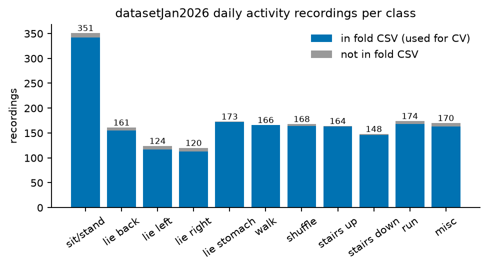

*datasetJan2026 daily activity recordings per class: Number of recordings per class. Grey: files present on disk but not listed in the official fold CSV (unknown subjects; excluded from CV, used only to train the final models).* (vector: `figures/data/recordings_per_class_har.pdf`)
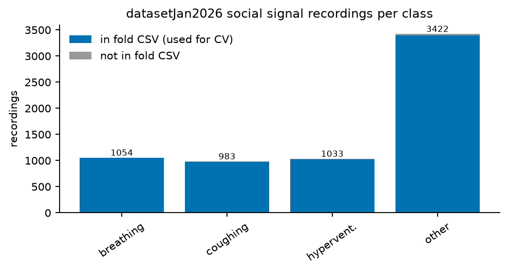

*datasetJan2026 social signal recordings per class: Number of recordings per class. Grey: files present on disk but not listed in the official fold CSV (unknown subjects; excluded from CV, used only to train the final models).* (vector: `figures/data/recordings_per_class_social.pdf`)

### 2.2 Group recordings

Both group members recorded the full CW2 protocol with the RESpeck and the app: Subject A (s2503795) 44 recordings, Subject B (s2952925) 44 recordings. Per person: sitting, standing and the four lying postures, each while breathing normally, coughing, hyperventilating, talking, eating (sitting/standing only), singing and laughing, plus the six dynamic activities.

**Quality checks** (`tables/real_data_quality.csv`): sampling rate 12.14 Hz median (range 8.56–13.32); missing values in 0 recordings; longest flat run 2 samples; clipped samples 0. Placement: median angle between each recording's gravity direction and the datasetJan2026 mean of its class 13.4°, 0 recording(s) flagged (> 35° or another issue).

**Use:** each member is one extra subject in the folds – all of a member's recordings (every activity) are in the test set of one fold and in the training set of the other nine; the two members are in different folds. Activity labels come from the posture or activity in the file name (a recording of sitting while coughing is *sitting/standing* for activities and *coughing* for social signals); only stationary recordings have a social label.

| task | person | fold | recordings | test_windows |
|---|---|---|---|---|
| har | s2503795 | 8 | 44 | 616 |
| har | s2952925 | 9 | 44 | 587 |
| social | s2503795 | 8 | 38 | 494 |
| social | s2952925 | 9 | 38 | 467 |

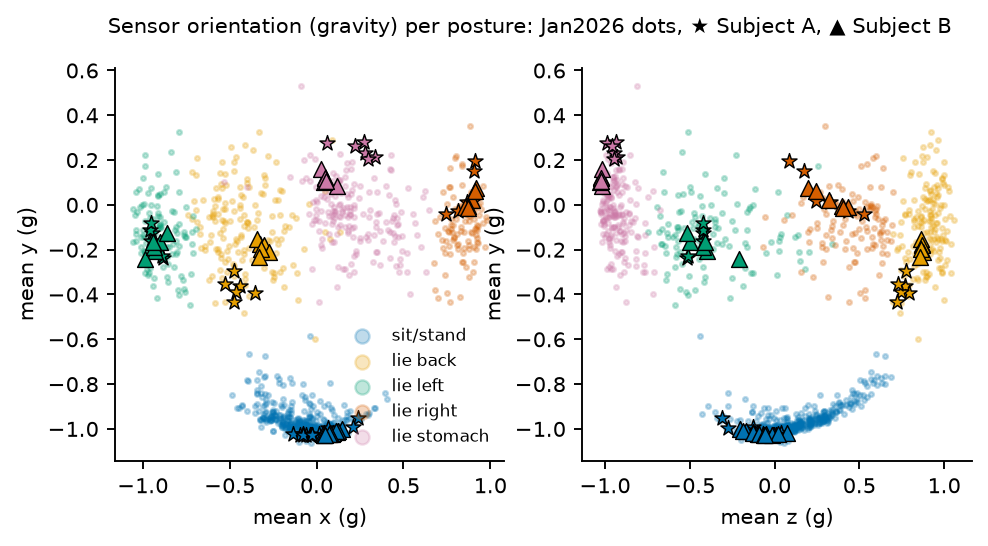

*Gravity orientation per posture: Mean acceleration of each static recording (= gravity direction = posture). Group members' recordings (large markers) fall inside the Jan2026 clusters, so sensor placement matches the dataset.* (vector: `figures/data/gravity_orientation.pdf`)
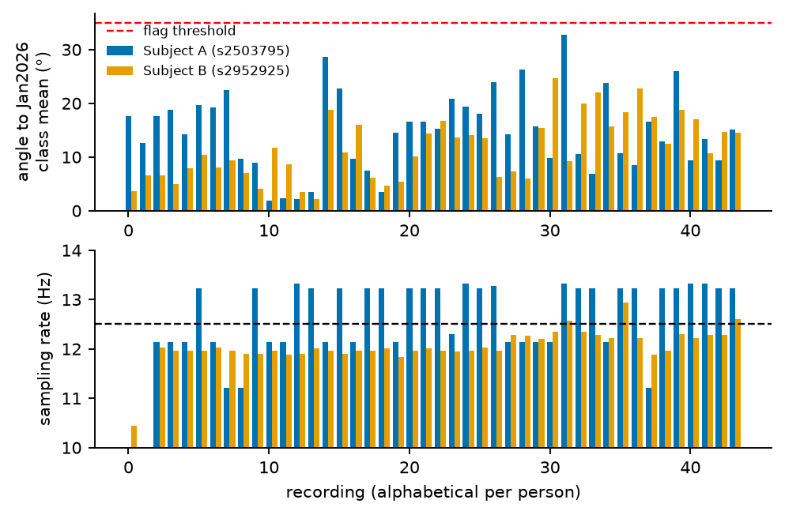

*Group recordings: quality checks: Per recording of each group member: angle between its gravity vector and the Jan2026 mean for the same class (placement check) and the sampling rate estimated from timestamps (nominal 12.5 Hz).* (vector: `figures/data/real_data_quality.pdf`)

## 3. Pre-processing, features and models

### 3.1 Windowing

Both models classify fixed windows of raw acceleration: **4 s (50 samples) for activities** and **6 s (75 samples) for social signals**. Activities are periodic at 1–3 Hz, so 4 s holds several gait cycles. The social window is a trade-off between holding whole breaths (2–5 s each) and reacting quickly in the app; it was chosen by measuring both (§6.6). Training windows overlap (step 25 samples = 2 s on datasetJan2026, step 6 on the much smaller group data); test windows use a 2 s step. In the app a new result is computed every 0.5 s (overlapping windows), so the display is never older than the latest data.

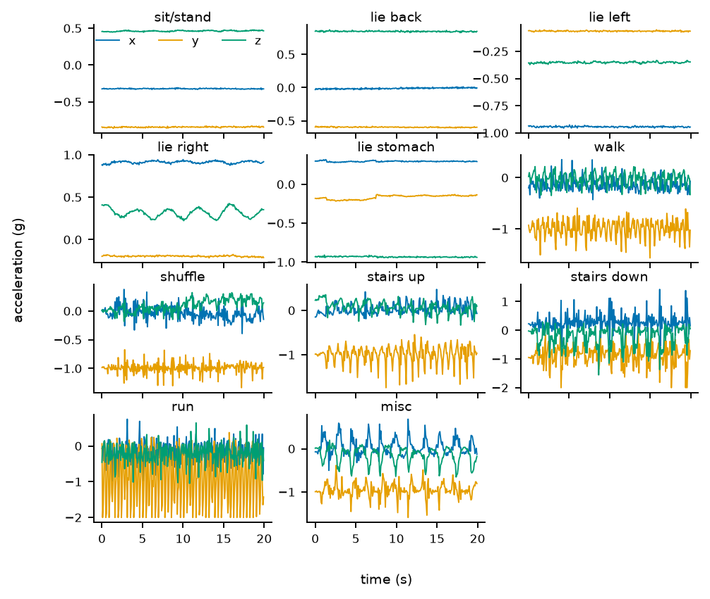

*Example raw signals (har): First 20 s of one recording per class (x, y, z in g). Posture shows up as the constant offset (gravity), activity as the oscillation around it.* (vector: `figures/data/example_signals_har.pdf`)
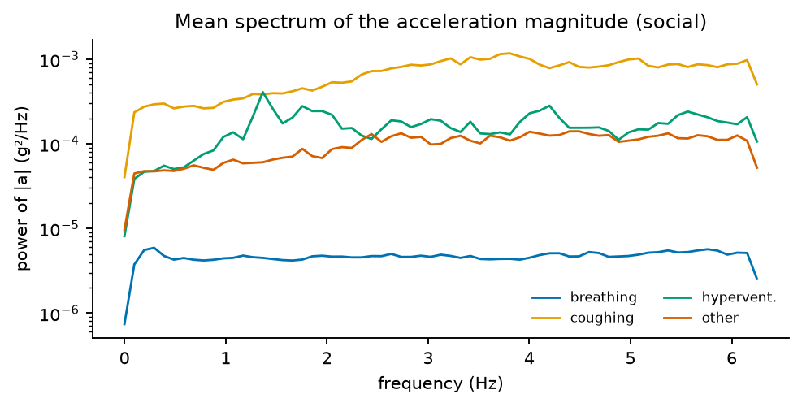

*Mean spectrum of the acceleration magnitude (social): Welch power spectrum of the gravity-free acceleration magnitude, averaged over up to 200 recordings per class. These frequency bands motivate the in-model band-power features.* (vector: `figures/data/spectra_social.pdf`)

### 3.2 Pre-processing inside the model

All pre-processing is part of the TensorFlow graph, so the phone feeds raw g values and the same computation runs in training and in the app. Every operation lowers to a TFLite builtin op (checked at export).

1. **Gravity split.** Gravity (= posture) is the mean of each axis over the window; the dynamic part is the window minus that mean, so posture and motion are separate inputs – important because breathing moves the chest by ~0.007 g while gravity is 1 g.
2. **Dynamic channels** (7): gravity-free x, y, z; magnitude |a| minus its mean (orientation-free); first difference of x, y, z (jerk).
3. **Spectral features**: log mean power in fixed frequency bands (Hann-tapered DFT as a matrix multiply). Activity bands [(0.3, 1.0), (1.0, 1.5), (1.5, 2.0), (2.0, 2.5), (2.5, 3.5), (3.5, 6.26)] Hz; social bands [(0.1, 0.4), (0.4, 0.8), (0.8, 1.5), (1.5, 3.0), (3.0, 6.26)] Hz (breathing, fast breathing, coughs/voice); plus log standard deviation of every dynamic channel.
4. **Normalisation**: per-branch z-scoring fitted on the training windows of each fold only.
5. **Augmentation (training only)**: random rotation about the body axis (±30°), small tilt (±10°), amplitude scaling (0.8–1.25) and Gaussian noise (0.002 g), applied on the fly.

### 3.3 Architectures (all ours)

All four share the gravity and spectral branches and the head (Dropout 0.3 → Dense 64 → Dropout 0.3 → softmax); they differ in how the dynamic channels are read:

- **Multi-branch CNN** (deployed for activities): four Conv1D blocks (32 k5, 32 k5 dilation 2, max-pool, 64 k3; Conv → BatchNorm → ReLU) → global average **and** max pooling.
- **Conv-GRU** (deployed for social signals): Conv1D stem (32 k5, BatchNorm, ReLU, max-pool 2) → GRU with 48 units, which models the order of events (inhale/exhale rhythm, a burst followed by recovery). Exported with an unrolled copy (builtin ops only).
- **Gravity-split MLP**: the dynamic channels flattened → Dense 64 → Dense 64.
- **Spectral-feature net**: no sequence branch at all – only gravity + band powers.

| task | model | params | size_kb | ms_per_window | parity_argmax_agreement |
|---|---|---|---|---|---|
| har | harry_cnn (final, trained) | 26112 | 133.1 | 0.026 | 1.0 |
| social | harry_rnn (final, trained) | 20017 | 235.8 | 0.076 | 1.0 |

## 4. Training

### 4.1 Recipe

| setting | value |
|---|---|
| optimiser | AdamW, weight decay 1e-4 |
| learning rate | 2e-3 with cosine decay to 5 % |
| epochs | 32, fixed in advance (no early stopping on test folds) |
| batch | 64 |
| loss | categorical cross-entropy, label smoothing 0.1 |
| class weights | activities: balanced; social: balanced^0.6 (§4.2) |
| augmentation | §3.2 |
| training data of fold k | datasetJan2026 folds ≠ k (windows every 25 samples) + the group member(s) not in fold k (every 6 samples), mixed |
| seeds | 0, 1, 2 (deployed architectures); 0 (others) |
| final models | the same recipe on everything: all datasetJan2026 recordings (incl. unlisted) + both members |

### 4.2 Class weighting for social signals

With fully balanced weights each class contributes equally to the loss, so the majority class *other* (~53 % of windows) is under-predicted. Weights are softened to w_c = (N / (K·n_c))^0.6: with balanced weights the effective prior of *other* is divided by ~3.3; a power of 0.6 leaves a factor of 3.3^0.4 ≈ 1.6. The sweep in §6.7 shows the whole trade-off curve.

### 4.3 Compute

Apple M1 Pro, 8 CPU cores, macOS-26.5.2-arm64-arm-64bit; Python 3.12.14, TensorFlow 2.21.0, Keras 3.15.1, scikit-learn 1.9.1. CPU only. 170 jobs, 16.4 CPU-job hours.

| job group | jobs | seconds total | seconds per job |
|---|---|---|---|
| baseline | 60 | 13488.0 | 225.0 |
| deploy | 8 | 10.0 | 1.0 |
| final | 2 | 799.0 | 400.0 |
| main | 60 | 22439.0 | 374.0 |
| sweep | 40 | 22238.0 | 556.0 |

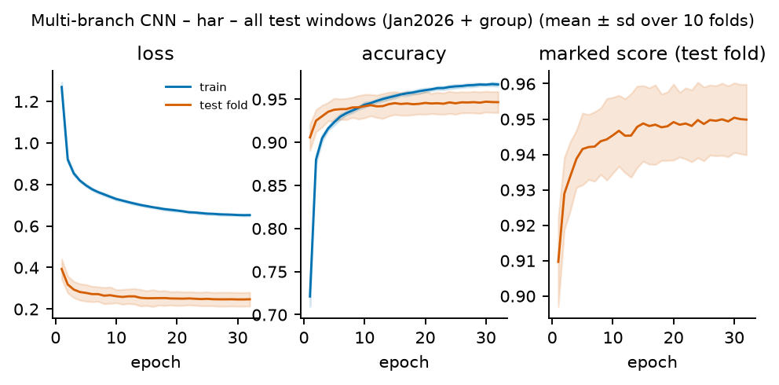

*Learning curves (har, all test windows (Jan2026 + group)): Training and held-out-fold loss/accuracy per epoch, mean ± sd over the 10 official folds. The test fold was only monitored, never used to stop or tune training (fixed epochs, as in Lab 3).* (vector: `figures/training/learning_curves_har_all.pdf`)
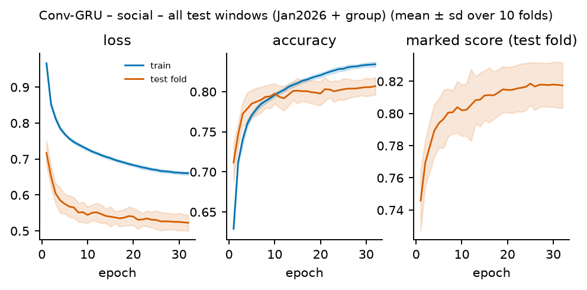

*Learning curves (social, all test windows (Jan2026 + group)): Training and held-out-fold loss/accuracy per epoch, mean ± sd over the 10 official folds. The test fold was only monitored, never used to stop or tune training (fixed epochs, as in Lab 3).* (vector: `figures/training/learning_curves_social_all.pdf`)

## 5. Evaluation protocol

### 5.1 Cross-validation

For each fold k = 0…9 a new model is trained from scratch on everything not in fold k and tested on fold k: the official datasetJan2026 fold k plus the group member assigned to fold k. Within each activity a subject is never in both sets (official fold files; each member is one subject). A test sample is a window (every 2 s). For each class, accuracy = share of its test windows classified correctly (recall), averaged over the 10 folds; group scores average the per-class values (static 5 classes, dynamic 6, each social class against 75 %).

### 5.2 Two scorings of the same predictions
- **All test windows** (headline): every window of the fold.
- **As marked**: only the datasetJan2026 windows of the fold – the CW3 marking's number. The models are the same; only which test windows are counted differs.
- **Per member**: the member's own fold, i.e. a model that never saw that person (§6.8).

### 5.3 Other metrics and statistics
Precision, F1, macro ROC-AUC, recording-level majority vote, log-loss, expected calibration error, spread over folds and seeds, 95 % confidence intervals over folds, and paired Wilcoxon signed-rank tests over the 10 folds (with 10 folds the smallest two-sided p is 0.002).

## 6. Results

### 6.1 Group scores and per-class accuracy

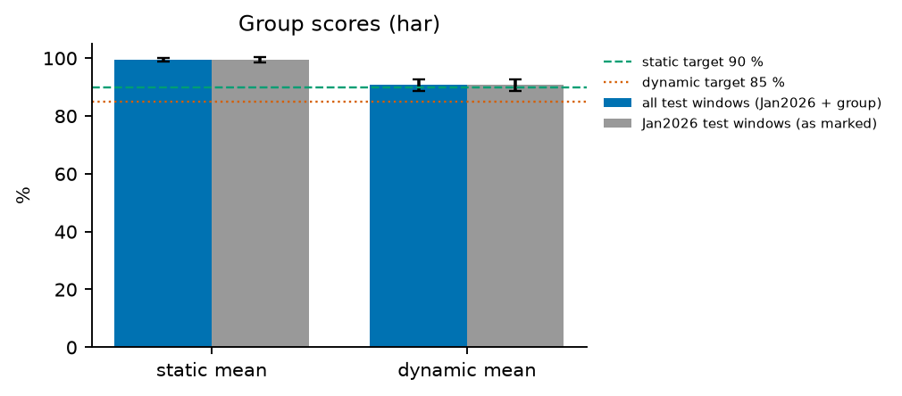

*Group scores (har): Marked group scores (mean over folds and seeds); error bars = sd over folds.* (vector: `figures/results/group_scores_har.pdf`)
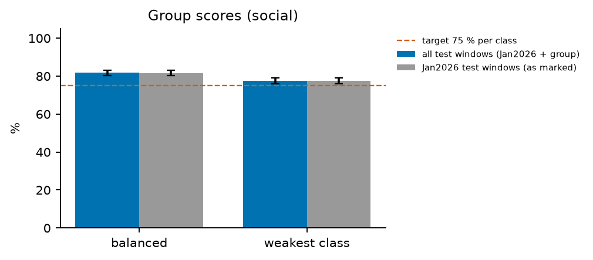

*Group scores (social): Marked group scores (mean over folds and seeds); error bars = sd over folds.* (vector: `figures/results/group_scores_social.pdf`)

**Activities – all test windows (Jan2026 + group)**

| class | recall | fold sd | seed sd | 95 % CI ± | worst fold | best fold | precision | F1 |
|---|---|---|---|---|---|---|---|---|
| sitting/standing | 97.5 | 3.7 | 0.22 | 2.7 | 90.9 | 100.0 | 98.6 | 98.0 |
| lying on back | 99.7 | 0.0 | 0.27 | 0.0 | 100.0 | 100.0 | 99.5 | 99.6 |
| lying left | 100.0 | 0.0 | 0.00 | 0.0 | 100.0 | 100.0 | 99.5 | 99.8 |
| lying right | 100.0 | 0.0 | 0.00 | 0.0 | 100.0 | 100.0 | 100.0 | 100.0 |
| lying on stomach | 99.7 | 1.0 | 0.09 | 0.7 | 96.8 | 100.0 | 99.5 | 99.6 |
| walking | 89.8 | 5.9 | 0.36 | 4.2 | 76.8 | 94.9 | 91.4 | 90.4 |
| shuffle walking | 88.0 | 7.2 | 0.20 | 5.2 | 73.2 | 98.2 | 83.9 | 85.7 |
| ascending stairs | 93.8 | 4.4 | 0.28 | 3.1 | 86.0 | 100.0 | 95.1 | 94.4 |
| descending stairs | 92.8 | 4.0 | 0.19 | 2.9 | 86.6 | 98.6 | 91.6 | 92.1 |
| running | 96.9 | 2.2 | 0.04 | 1.6 | 93.6 | 100.0 | 95.6 | 96.2 |
| miscellaneous movements | 82.8 | 3.8 | 1.00 | 2.7 | 77.7 | 89.0 | 86.0 | 84.2 |

**Activities – Jan2026 test windows (as marked)**

| class | recall | fold sd | seed sd | 95 % CI ± | worst fold | best fold | precision | F1 |
|---|---|---|---|---|---|---|---|---|
| sitting/standing | 97.4 | 4.2 | 0.21 | 3.0 | 90.0 | 100.0 | 98.5 | 97.9 |
| lying on back | 99.7 | 0.0 | 0.27 | 0.0 | 100.0 | 100.0 | 99.5 | 99.6 |
| lying left | 100.0 | 0.0 | 0.00 | 0.0 | 100.0 | 100.0 | 99.5 | 99.7 |
| lying right | 100.0 | 0.0 | 0.00 | 0.0 | 100.0 | 100.0 | 100.0 | 100.0 |
| lying on stomach | 99.7 | 1.0 | 0.09 | 0.7 | 96.8 | 100.0 | 99.5 | 99.6 |
| walking | 89.7 | 5.9 | 0.37 | 4.2 | 76.8 | 94.9 | 91.5 | 90.4 |
| shuffle walking | 88.0 | 7.2 | 0.21 | 5.2 | 73.2 | 98.2 | 84.0 | 85.8 |
| ascending stairs | 93.8 | 4.4 | 0.27 | 3.1 | 86.0 | 100.0 | 95.1 | 94.3 |
| descending stairs | 92.7 | 4.2 | 0.19 | 3.0 | 85.6 | 98.6 | 91.7 | 92.1 |
| running | 96.9 | 2.2 | 0.04 | 1.6 | 93.6 | 100.0 | 95.5 | 96.2 |
| miscellaneous movements | 82.7 | 3.7 | 1.00 | 2.7 | 77.7 | 88.3 | 85.9 | 84.1 |

**Social signals – all test windows (Jan2026 + group)**

| class | recall | fold sd | seed sd | 95 % CI ± | worst fold | best fold | precision | F1 |
|---|---|---|---|---|---|---|---|---|
| normal breathing | 86.4 | 3.1 | 0.39 | 2.2 | 78.5 | 90.5 | 69.5 | 77.0 |
| coughing | 82.3 | 3.7 | 0.21 | 2.6 | 77.0 | 88.6 | 73.5 | 77.6 |
| hyperventilation | 80.2 | 1.9 | 0.33 | 1.4 | 76.7 | 82.4 | 78.7 | 79.4 |
| other | 78.3 | 1.8 | 0.47 | 1.3 | 75.3 | 81.3 | 88.6 | 83.1 |

**Social signals – Jan2026 test windows (as marked)**

| class | recall | fold sd | seed sd | 95 % CI ± | worst fold | best fold | precision | F1 |
|---|---|---|---|---|---|---|---|---|
| normal breathing | 86.4 | 3.0 | 0.38 | 2.1 | 78.5 | 90.0 | 69.5 | 77.0 |
| coughing | 82.1 | 4.0 | 0.21 | 2.9 | 76.0 | 88.6 | 73.3 | 77.4 |
| hyperventilation | 80.0 | 1.9 | 0.34 | 1.4 | 76.7 | 82.4 | 78.6 | 79.3 |
| other | 78.2 | 1.8 | 0.46 | 1.3 | 75.3 | 80.9 | 88.5 | 83.0 |

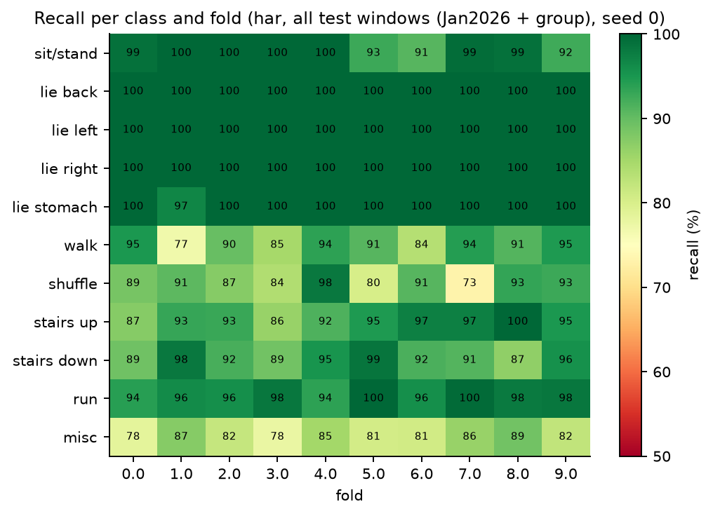

*Recall per class and fold (har, all test windows (Jan2026 + group), seed 0): Every fold's recall per class: shows which folds (groups of subjects) are hard.* (vector: `figures/results/fold_heatmap_har_all.pdf`)
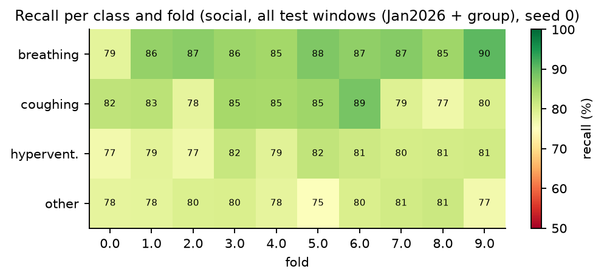

*Recall per class and fold (social, all test windows (Jan2026 + group), seed 0): Every fold's recall per class: shows which folds (groups of subjects) are hard.* (vector: `figures/results/fold_heatmap_social_all.pdf`)
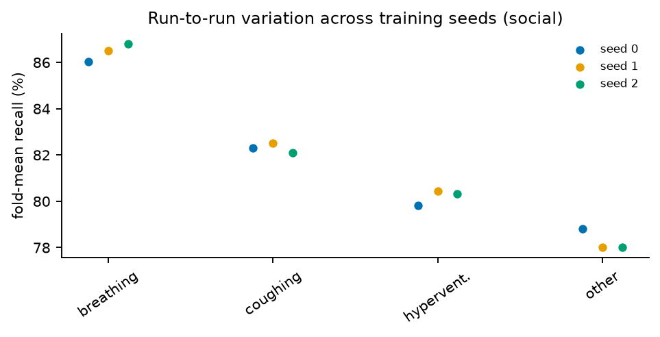

*Run-to-run variation across training seeds (social): The marked number for each of the 3 training seeds: the spread shows how much of a difference between models could be chance.* (vector: `figures/results/seed_variation_social.pdf`)

### 6.2 Other metrics

| task | scored on | window accuracy % | macro F1 % | macro AUC % | recording vote % | ECE % | log-loss |
|---|---|---|---|---|---|---|---|
| har | all test windows (Jan2026 + group) | 94.7 | 94.6 | 99.6 | 96.4 | 6.8 | 0.246 |
| har | Jan2026 test windows (as marked) | 94.6 | 94.5 | 99.6 | 96.3 | 6.7 | 0.249 |
| social | all test windows (Jan2026 + group) | 80.5 | 79.3 | 95.1 | 87.2 | 3.5 | 0.525 |
| social | Jan2026 test windows (as marked) | 80.4 | 79.2 | 95.1 | 87.1 | 3.4 | 0.527 |

Recording vote = the majority class over all windows of a test recording. ECE = expected calibration error (gap between confidence and accuracy).

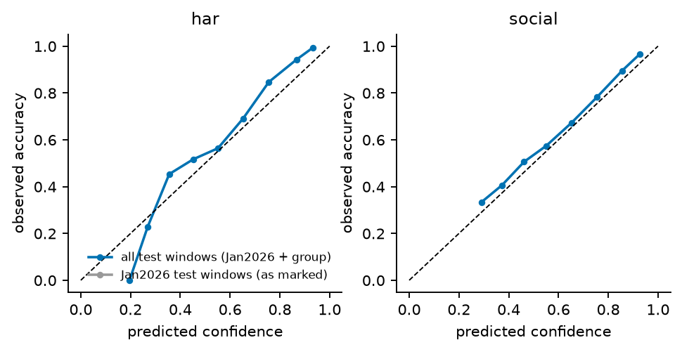

*Reliability diagram: Accuracy of test windows grouped by the model's confidence. On the diagonal = confidence can be trusted (e.g. for showing a confidence value in the app).* (vector: `figures/results/calibration.pdf`)
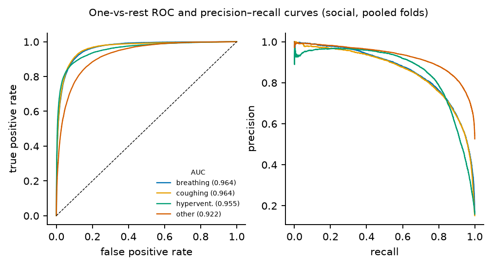

*ROC and PR curves (social): Per-class ROC (with AUC) and precision–recall curves of the headline models, all test windows pooled.* (vector: `figures/results/roc_pr_social.pdf`)

### 6.3 Confusions

Most frequent activity confusions (share of the true class, all folds pooled):

- **miscellaneous movements → shuffle walking**: 8.6 % of miscellaneous movements windows (198 windows) – miscellaneous movements contain small steps, turns and weight shifts that look like slow, irregular shuffling over a 4 s window.
- **walking → shuffle walking**: 4.6 % of walking windows (108 windows) – both are level walking at a similar cadence; shuffling only shortens the stride and lowers the vertical bounce, so a chest sensor sees a scaled-down version of the same rhythm.
- **shuffle walking → walking**: 4.1 % of shuffle walking windows (94 windows) – both are level walking at a similar cadence; shuffling only shortens the stride and lowers the vertical bounce, so a chest sensor sees a scaled-down version of the same rhythm.
- **shuffle walking → miscellaneous movements**: 4.0 % of shuffle walking windows (93 windows) – miscellaneous movements contain small steps, turns and weight shifts that look like slow, irregular shuffling over a 4 s window.
- **ascending stairs → descending stairs**: 3.2 % of ascending stairs windows (73 windows) – stairs up and down have the same step rhythm; they differ mainly in the timing of the impact peak within each step, a subtle cue in 4 s at 12.5 Hz.
- **miscellaneous movements → running**: 2.8 % of miscellaneous movements windows (65 windows) – vigorous miscellaneous movements (jumping, fast turns) share the high-energy bursts of running.

Most frequent social confusions (share of the true class, all folds pooled):

- **normal breathing → other**: 12.2 % of normal breathing windows (1676 windows) – talking, eating, singing and laughing are intermittent: an 8 s window often contains pauses that are just normal breathing, and the vocal vibrations are small at 12.5 Hz.
- **coughing → other**: 11.4 % of coughing windows (1450 windows) – laughing and some eating movements produce short abdominal bursts that resemble coughs.
- **hyperventilation → other**: 10.6 % of hyperventilation windows (1408 windows) – singing and laughing involve deep, fast breaths like hyperventilation.
- **other → normal breathing**: 10.2 % of other windows (4506 windows) – talking, eating, singing and laughing are intermittent: an 8 s window often contains pauses that are just normal breathing, and the vocal vibrations are small at 12.5 Hz.
- **other → coughing**: 6.7 % of other windows (2958 windows) – laughing and some eating movements produce short abdominal bursts that resemble coughs.
- **coughing → hyperventilation**: 6.3 % of coughing windows (795 windows) – both produce strong, fast chest movements; a run of coughs and forced rapid breathing overlap in amplitude and rate.

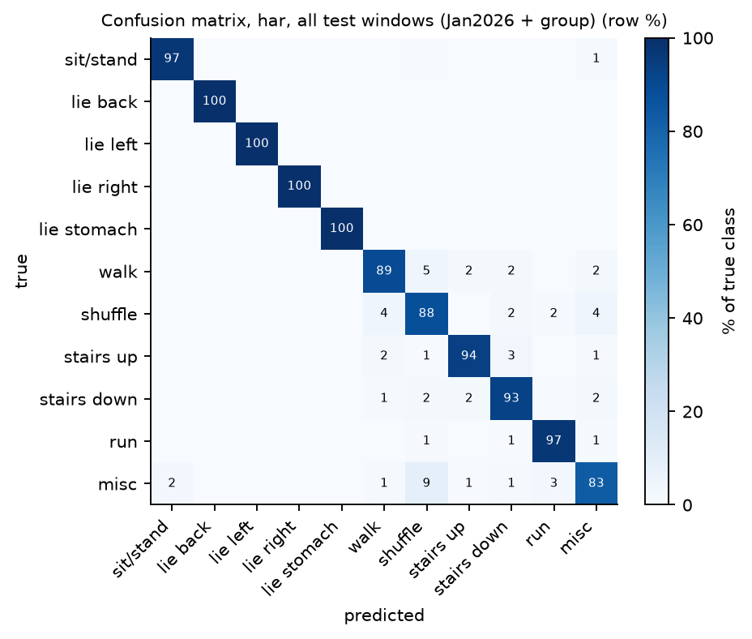

*Confusion matrix, har, all test windows (Jan2026 + group) (row %): All test windows of the 10 folds pooled (seed 0). Rows = true class; the diagonal is the recall.* (vector: `figures/results/confusion_har_all_pct.pdf`)
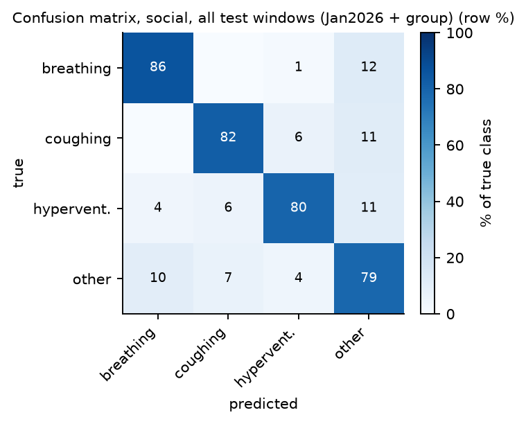

*Confusion matrix, social, all test windows (Jan2026 + group) (row %): All test windows of the 10 folds pooled (seed 0). Rows = true class; the diagonal is the recall.* (vector: `figures/results/confusion_social_all_pct.pdf`)
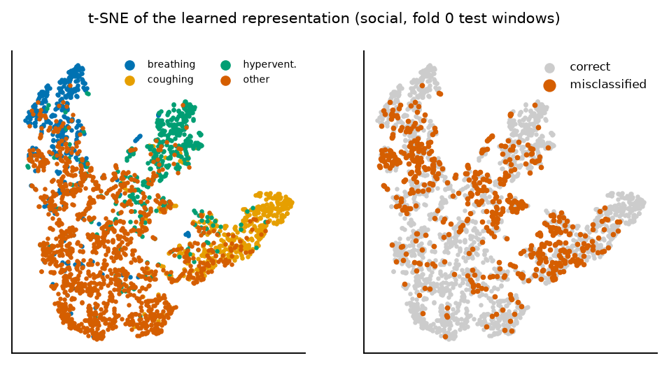

*t-SNE embedding (social): Penultimate-layer activations of held-out windows, projected to 2-D. Overlapping clusters are the classes the model confuses.* (vector: `figures/results/tsne_social.pdf`)

### 6.4 Per-recording behaviour

Errors concentrate in a minority of recordings (whole people / sessions). The worst test recordings (seed 0):

| task | class | source | file | fold | n | frac_correct |
|---|---|---|---|---|---|---|
| social | coughing | datasetJan2026 | coughing (184).csv | 2.0 | 13 | 0.0 |
| social | hyperventilation | datasetJan2026 | hyperventilating (227).csv | 9.0 | 13 | 0.0 |
| social | hyperventilation | datasetJan2026 | N_497.csv | 2.0 | 12 | 0.0 |
| social | other | datasetJan2026 | other (332).csv | 4.0 | 13 | 0.0 |
| social | hyperventilation | datasetJan2026 | N_554.csv | 2.0 | 13 | 0.0 |
| social | coughing | datasetJan2026 | coughing (199).csv | 9.0 | 13 | 0.0 |
| social | coughing | datasetJan2026 | N_399.csv | 5.0 | 13 | 0.0 |
| social | hyperventilation | datasetJan2026 | hyperventilating (72).csv | 8.0 | 13 | 0.0 |

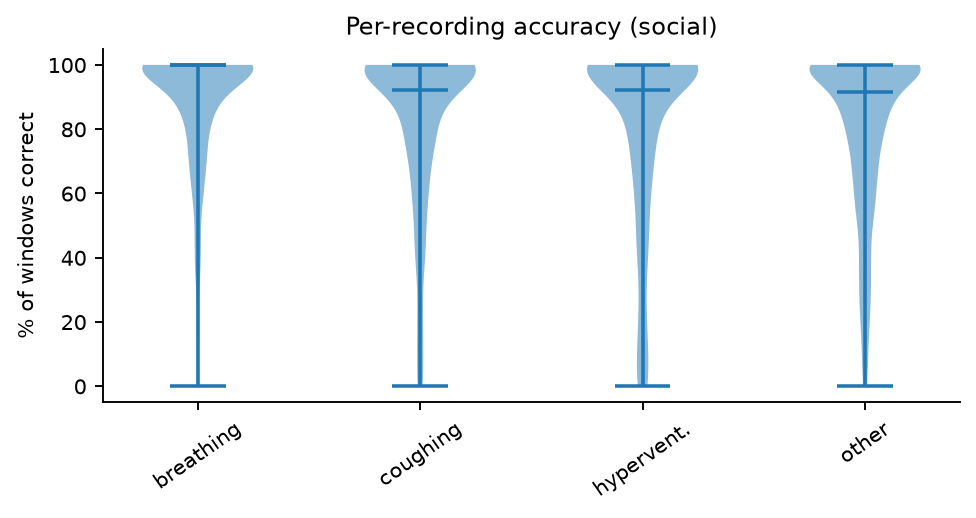

*Per-recording accuracy (social): Share of correctly classified windows within each test recording. Mass near 0 means whole recordings (people) are misread, not single windows.* (vector: `figures/results/recording_accuracy_social.pdf`)

### 6.5 Architecture comparison (our four models)

| task | model | dynamic % (all) | dynamic % (marked) | static % (all) | params | KB | ms/window | balanced % (all) | weakest % (all) | balanced % (marked) | weakest % (marked) |
|---|---|---|---|---|---|---|---|---|---|---|---|
| har | ★ Multi-branch CNN | 90.6 | 90.5 | 99.4 | 26112 | 130.8 | 0.025 |  |  |  |  |
| har | Spectral-feature net | 80.8 | 80.9 | 99.3 | 5009 | 44.1 | 0.007 |  |  |  |  |
| har | Gravity-split MLP | 82.9 | 83.0 | 99.3 | 35744 | 165.5 | 0.010 |  |  |  |  |
| har | Conv-GRU | 90.5 | 90.4 | 99.3 | 21152 | 186.3 | 0.050 |  |  |  |  |
| social | Multi-branch CNN |  |  |  | 42065 | 205.9 | 0.074 | 81.6 | 78.0 | 81.5 | 77.7 |
| social | Spectral-feature net |  |  |  | 3874 | 52.0 | 0.008 | 73.9 | 64.6 | 73.8 | 64.6 |
| social | Gravity-split MLP |  |  |  | 45809 | 217.1 | 0.012 | 73.9 | 65.9 | 73.8 | 66.0 |
| social | ★ Conv-GRU |  |  |  | 20017 | 230.8 | 0.075 | 81.7 | 77.8 | 81.6 | 77.7 |

Paired tests (deployed architecture minus the other one, percentage points, over the 10 folds, seed 0):

| comparison | scope | metric | mean_diff | folds_a_better | p_wilcoxon |
|---|---|---|---|---|---|
| har: Multi-branch CNN vs Spectral-feature net | all | static | 0.07 | 4 | 0.3125 |
| har: Multi-branch CNN vs Gravity-split MLP | all | static | 0.07 | 6 | 0.1562 |
| har: Multi-branch CNN vs Conv-GRU | all | static | 0.1 | 4 | 0.125 |
| har: Multi-branch CNN vs Spectral-feature net | all | dynamic | 9.77 | 10 | 0.002 |
| har: Multi-branch CNN vs Gravity-split MLP | all | dynamic | 7.63 | 10 | 0.002 |
| har: Multi-branch CNN vs Conv-GRU | all | dynamic | 0.1 | 5 | 0.9219 |
| social: Conv-GRU vs Multi-branch CNN | all | social | 0.14 | 5 | 0.7695 |
| social: Conv-GRU vs Spectral-feature net | all | social | 7.82 | 10 | 0.002 |
| social: Conv-GRU vs Gravity-split MLP | all | social | 7.82 | 10 | 0.002 |
| social: Conv-GRU vs Multi-branch CNN | all | social_min | -0.16 | 4 | 1.0 |
| social: Conv-GRU vs Spectral-feature net | all | social_min | 13.22 | 10 | 0.002 |
| social: Conv-GRU vs Gravity-split MLP | all | social_min | 11.88 | 10 | 0.002 |
| har: Multi-branch CNN vs Spectral-feature net | jan | static | 0.02 | 2 | 0.875 |
| har: Multi-branch CNN vs Gravity-split MLP | jan | static | 0.04 | 4 | 0.4375 |
| har: Multi-branch CNN vs Conv-GRU | jan | static | 0.08 | 2 | 0.75 |
| har: Multi-branch CNN vs Spectral-feature net | jan | dynamic | 9.61 | 10 | 0.002 |
| har: Multi-branch CNN vs Gravity-split MLP | jan | dynamic | 7.46 | 10 | 0.002 |
| har: Multi-branch CNN vs Conv-GRU | jan | dynamic | 0.09 | 5 | 0.9219 |
| social: Conv-GRU vs Multi-branch CNN | jan | social | 0.12 | 5 | 0.7695 |
| social: Conv-GRU vs Spectral-feature net | jan | social | 7.76 | 10 | 0.002 |
| social: Conv-GRU vs Gravity-split MLP | jan | social | 7.77 | 10 | 0.002 |
| social: Conv-GRU vs Multi-branch CNN | jan | social_min | -0.05 | 4 | 0.7344 |
| social: Conv-GRU vs Spectral-feature net | jan | social_min | 13.05 | 10 | 0.002 |
| social: Conv-GRU vs Gravity-split MLP | jan | social_min | 11.71 | 10 | 0.002 |

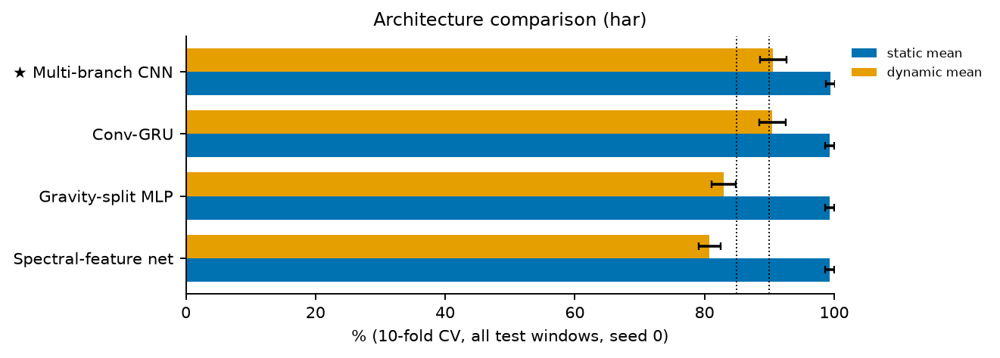

*Architecture comparison (har): Each of our four architectures trained and tested on the same folds with the same data. ★ = deployed model. Error bars = sd over folds.* (vector: `figures/comparison/architectures_har.pdf`)
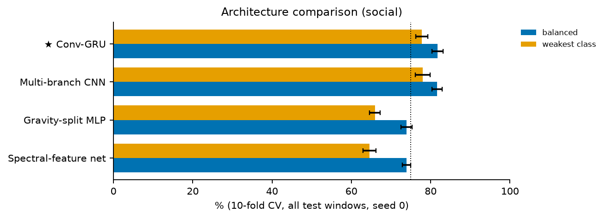

*Architecture comparison (social): Each of our four architectures trained and tested on the same folds with the same data. ★ = deployed model. Error bars = sd over folds.* (vector: `figures/comparison/architectures_social.pdf`)
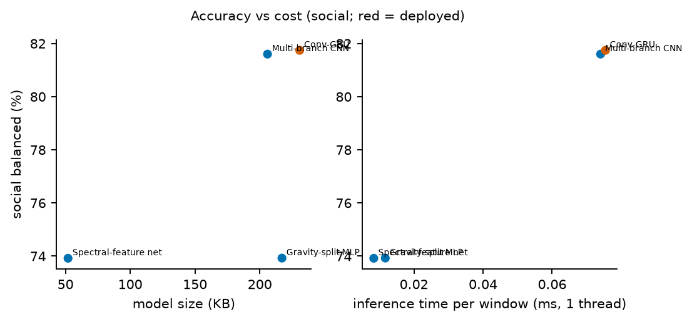

*Accuracy vs model cost (social): Trade-off between accuracy and TFLite size / single-window latency on this Mac (a phone is slower, but the ranking holds).* (vector: `figures/comparison/accuracy_vs_cost_social.pdf`)

### 6.6 Choosing the social window (speed vs accuracy)

In the app a social result changes only once about half of the window holds the new signal, plus the wait for the RESpeck's next data packet (32 samples = 2.56 s, 1.3 s on average). The target was ≈ 4–4.5 s from a change to the screen (≈ 2 s of data transmission + ≈ 2 s detection), like activities. Candidates were measured on the official folds (datasetJan2026 training, seed 0) and with a replay of the app (32-sample packets, a result every 0.5 s) on same-posture changes in both members' recordings, which those models never saw (`results/social_window_study/`).

| candidate | normal breathing | coughing | hyperventilation | other | balanced | weakest | median s (ours) | mean s (ours) | p90 s (ours) | median s (Jan pairs) | never shown % (ours) |
|---|---|---|---|---|---|---|---|---|---|---|---|
| w100 | 87.6 | 82.2 | 81.6 | 80.0 | 82.9 | 80.0 | 6.1 | 6.6 | 9.3 | 6.1 | 3.0 |
| w75 | 86.2 | 81.8 | 79.3 | 77.8 | 81.3 | 77.8 | 5.4 | 5.6 | 8.6 | 5.4 | 3.0 |
| w62 | 86.2 | 82.1 | 78.6 | 76.2 | 80.8 | 76.2 | 4.8 | 5.0 | 8.0 | 5.4 | 4.0 |
| w50 | 86.3 | 79.8 | 78.1 | 74.2 | 79.6 | 74.2 | 4.2 | 4.9 | 8.6 | 4.8 | 4.0 |
| w100rec | 87.9 | 83.0 | 81.3 | 77.3 | 82.4 | 77.3 | 5.4 | 5.8 | 9.3 | 4.8 | 2.0 |

Rule (decided before the results): the fastest candidate whose every class is ≥ 77 % (2 points above the mark). Chosen: **w75** (6 s). Candidates meeting the rule (median s until shown on our recordings): w75 5.4 s, w100rec 5.4 s, w100 6.1 s.

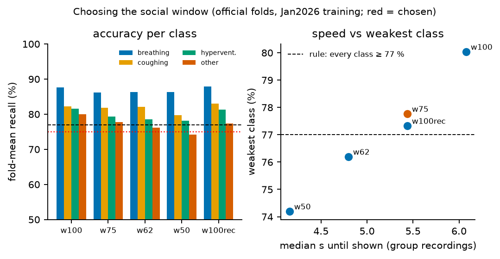

*Choosing the social window: Candidates: 4/5/6/8 s windows and an 8 s model trained to answer from the most recent seconds (rec). Left: marked per-class recall; right: replayed app latency (32-sample packets, 0.5 s updates) against the weakest class. The fastest candidate keeping every class ≥ 77 % is used.* (vector: `figures/real/social_window_choice.pdf`)
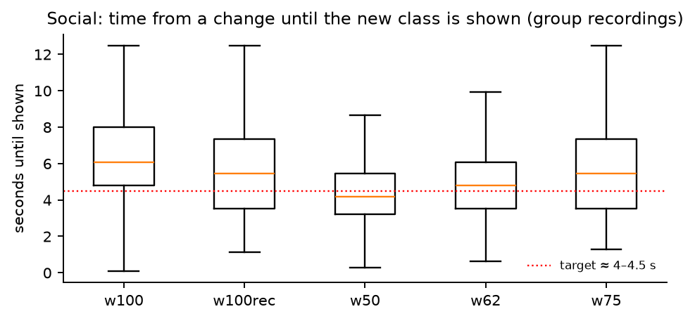

*Social latency per window candidate: App replay on same-posture changes in both members' recordings (models never trained on them): RESpeck packets of 32 samples (2.56 s), a result every 0.5 s.* (vector: `figures/real/social_latency.pdf`)

### 6.7 Class-weight sweep (social)

| power | normal breathing | coughing | hyperventilation | other | weakest | balanced |
|---|---|---|---|---|---|---|
| 0.0 | 76.6 | 76.3 | 75.8 | 87.7 | 75.8 | 79.1 |
| 0.3 | 81.4 | 80.1 | 78.0 | 83.7 | 78.0 | 80.8 |
| 0.6 | 86.4 | 82.3 | 80.2 | 78.3 | 78.3 | 81.8 |
| 0.8 | 88.1 | 83.9 | 80.5 | 74.9 | 74.9 | 81.9 |
| 1.0 | 89.4 | 85.8 | 81.2 | 70.9 | 70.9 | 81.8 |

Power 0 = no class weights, 1 = fully balanced. Raising the power moves accuracy from *other* to the three smaller classes. The sweep was examined after the choice of 0.6, so report it as a sensitivity analysis.

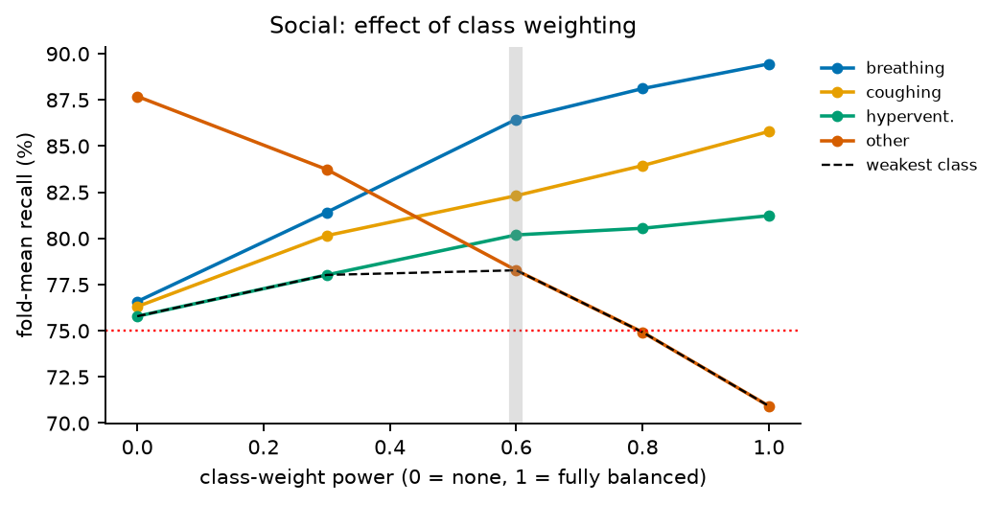

*Class-weight sweep (social): Each class's marked recall as the class weights move from none (0) to fully balanced (1). The grey band is the chosen setting.* (vector: `figures/comparison/class_weight_sweep.pdf`)

### 6.8 The group members as unseen test subjects

Each member's fold is a model that never saw that person (mean of the per-class recalls, 3 seeds):

| task | person | fold | balanced accuracy % |
|---|---|---|---|
| har | Subject A (s2503795) | 8.0 | 97.9 |
| har | Subject B (s2952925) | 9.0 | 99.0 |
| social | Subject A (s2503795) | 8.0 | 93.1 |
| social | Subject B (s2952925) | 9.0 | 93.7 |

Per class (%):

| task | class | Subject A (s2503795) | Subject B (s2952925) |
|---|---|---|---|
| har | ascending stairs | 100.0 | 100.0 |
| har | descending stairs | 100.0 | 100.0 |
| har | lying on back | 100.0 | 100.0 |
| har | lying left | 100.0 | 100.0 |
| har | lying right | 100.0 | 100.0 |
| har | lying on stomach | 99.2 | 100.0 |
| har | miscellaneous movements | 95.2 | 100.0 |
| har | walking | 100.0 | 100.0 |
| har | running | 100.0 | 100.0 |
| har | shuffle walking | 85.7 | 90.5 |
| har | sitting/standing | 96.6 | 98.3 |
| social | normal breathing | 93.6 | 98.6 |
| social | coughing | 94.9 | 98.2 |
| social | hyperventilation | 97.0 | 99.1 |
| social | other | 86.8 | 79.0 |

Social by posture (balanced %, seed 0):

| person | all | sitting/standing |
|---|---|---|
| Subject A (s2503795) | 92.5 | 92.5 |
| Subject B (s2952925) | 94.9 | 94.9 |

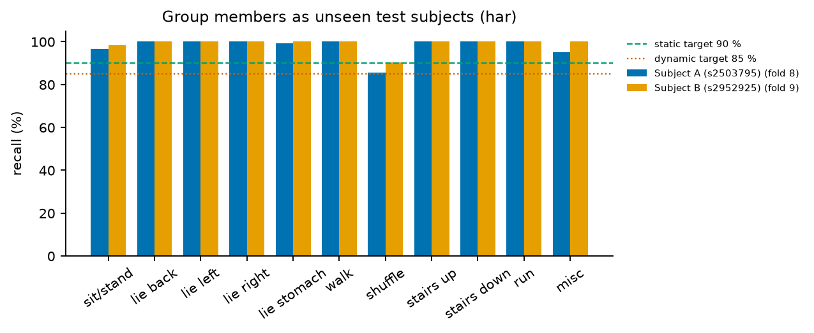

*Group members as unseen subjects (har): Each member's recordings are the test set of one fold, so these models never saw that person (the other member and the other 9 Jan2026 folds were in training). Mean over the 3 seeds.* (vector: `figures/real/person_har.pdf`)
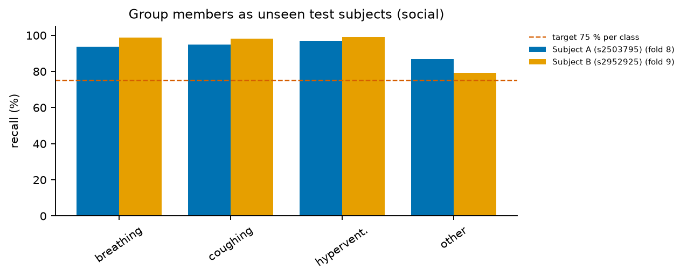

*Group members as unseen subjects (social): Each member's recordings are the test set of one fold, so these models never saw that person (the other member and the other 9 Jan2026 folds were in training). Mean over the 3 seeds.* (vector: `figures/real/person_social.pdf`)

**[fill in] Live real-time test.** Use the app's *Tools → Real-time test* and *Latency test* with every group member and every class; report the table of trials, the percentage correct and the time until shown, and compare with §1, §6.6 and §6.8.

### 6.9 Deployment cost

| task | model | window | params | size_kb | ms_per_window | ms_p90 | parity_argmax_agreement | parity_max_abs_dprob |
|---|---|---|---|---|---|---|---|---|
| har | Multi-branch CNN | 50 | 26112 | 130.7969 | 0.0253 | 0.0264 |  |  |
| har | Spectral-feature net | 50 | 5009 | 44.1133 | 0.007 | 0.0071 |  |  |
| har | Gravity-split MLP | 50 | 35744 | 165.4805 | 0.0099 | 0.01 |  |  |
| har | Conv-GRU | 50 | 21152 | 186.3398 | 0.0505 | 0.0518 |  |  |
| social | Multi-branch CNN | 75 | 42065 | 205.9492 | 0.074 | 0.0753 |  |  |
| social | Spectral-feature net | 75 | 3874 | 51.9805 | 0.0084 | 0.0087 |  |  |
| social | Gravity-split MLP | 75 | 45809 | 217.0977 | 0.0117 | 0.0118 |  |  |
| social | Conv-GRU | 75 | 20017 | 230.7695 | 0.0754 | 0.0761 |  |  |
| har | Multi-branch CNN – final | 50 | 26112 | 133.1 | 0.0259 |  | 1.0 | 0.0 |
| social | Conv-GRU – final | 75 | 20017 | 235.8 | 0.0761 |  | 1.0 | 0.0 |

Single-thread TFLite on the development Mac; a phone is slower but still far below the 0.5 s update interval. Parity = agreement between the Keras model and the exported TFLite file on the group recordings.

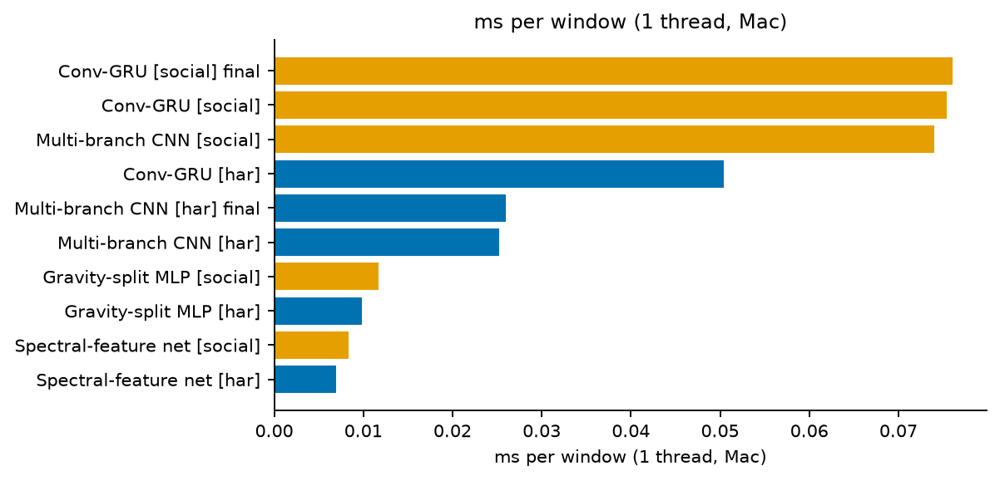

*ms per window (1 thread, Mac): Deployment cost of each of our architectures (blue = HAR, orange = social).* (vector: `figures/deploy/inference_time.pdf`)
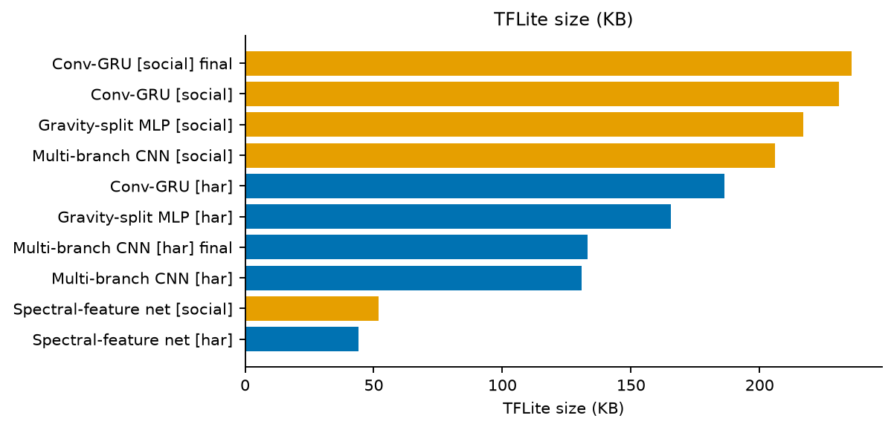

*TFLite size (KB): Deployment cost of each of our architectures (blue = HAR, orange = social).* (vector: `figures/deploy/model_size.pdf`)

## 7. Critical analysis (material for Results and Discussion)

### 7.1 Why some methods performed better

- **Activities (dynamic mean), all test windows:** Multi-branch CNN 90.6, Conv-GRU 90.5, Gravity-split MLP 82.9, Spectral-feature net 80.8.

- **Social (balanced), all test windows:** Conv-GRU 81.7, Multi-branch CNN 81.6, Gravity-split MLP 73.9, Spectral-feature net 73.9.

- **Separating gravity from motion**: breathing moves the chest by a few milli-g while posture changes gravity by up to 1 g; feeding them as separate, individually normalised inputs lets the small signal be seen.
- **Sequence models beat summaries**: the spectral-feature net and the MLP only see summaries / fixed positions; the CNN and GRU learn local shapes (steps, coughs) wherever they occur in the window.
- **Frequency bands** encode breathing rate and gait cadence directly and stabilise all models.
- **Recipe**: augmentation (sensor rotation), label smoothing and class weighting matter as much as the architecture for unseen subjects.

### 7.2 Most confused classes and why

- **miscellaneous movements → shuffle walking**: 8.6 % of miscellaneous movements windows (198 windows) – miscellaneous movements contain small steps, turns and weight shifts that look like slow, irregular shuffling over a 4 s window.
- **walking → shuffle walking**: 4.6 % of walking windows (108 windows) – both are level walking at a similar cadence; shuffling only shortens the stride and lowers the vertical bounce, so a chest sensor sees a scaled-down version of the same rhythm.
- **shuffle walking → walking**: 4.1 % of shuffle walking windows (94 windows) – both are level walking at a similar cadence; shuffling only shortens the stride and lowers the vertical bounce, so a chest sensor sees a scaled-down version of the same rhythm.
- **shuffle walking → miscellaneous movements**: 4.0 % of shuffle walking windows (93 windows) – miscellaneous movements contain small steps, turns and weight shifts that look like slow, irregular shuffling over a 4 s window.
- **ascending stairs → descending stairs**: 3.2 % of ascending stairs windows (73 windows) – stairs up and down have the same step rhythm; they differ mainly in the timing of the impact peak within each step, a subtle cue in 4 s at 12.5 Hz.
- **miscellaneous movements → running**: 2.8 % of miscellaneous movements windows (65 windows) – vigorous miscellaneous movements (jumping, fast turns) share the high-energy bursts of running.

- **normal breathing → other**: 12.2 % of normal breathing windows (1676 windows) – talking, eating, singing and laughing are intermittent: an 8 s window often contains pauses that are just normal breathing, and the vocal vibrations are small at 12.5 Hz.
- **coughing → other**: 11.4 % of coughing windows (1450 windows) – laughing and some eating movements produce short abdominal bursts that resemble coughs.
- **hyperventilation → other**: 10.6 % of hyperventilation windows (1408 windows) – singing and laughing involve deep, fast breaths like hyperventilation.
- **other → normal breathing**: 10.2 % of other windows (4506 windows) – talking, eating, singing and laughing are intermittent: an 8 s window often contains pauses that are just normal breathing, and the vocal vibrations are small at 12.5 Hz.
- **other → coughing**: 6.7 % of other windows (2958 windows) – laughing and some eating movements produce short abdominal bursts that resemble coughs.
- **coughing → hyperventilation**: 6.3 % of coughing windows (795 windows) – both produce strong, fast chest movements; a run of coughs and forced rapid breathing overlap in amplitude and rate.

### 7.3 Cross-validation vs real time

Expected differences, to discuss against the live test: (1) CV scores single windows from settled recordings, whereas live use includes changes, where the first seconds after a change are necessarily wrong (latency, §6.6); (2) live users wear the sensor slightly differently (§2.2, §6.8); (3) the app smooths activity results and shows social results only while still, which raises displayed accuracy for steady activities but delays changes; (4) live trials are few, so their percentages have wide confidence intervals.

### 7.4 Limitations

- Fold-level spread shows that some groups of subjects are much harder than others (§6.1 heatmaps).
- Only two group members provide real-world data, so the unseen-person result rests on two people.
- Hyper-parameters (epochs, learning rate) were fixed from earlier experiments; the class-weight power and the social window were chosen from results on the official folds (sensitivity analyses provided).
- Windows from one recording are correlated, so fold-level, not window-level, statistics are used.
- Accelerometer only at 12.5 Hz: voice is not observable; talking and singing are recognised through breathing-pattern changes.

### 7.5 Improvements / future work

- More real users recorded with the deployed app.
- Ensembling the CNN and GRU social models, or averaging over consecutive overlapping windows.
- Nested cross-validation for hyper-parameters; per-user calibration (a short personal fine-tune in the app).
- Quantisation (int8) to cut model size and power further.

## 8. Testing and verification of the models

- **Keras ↔ TFLite parity**: every exported model is run on all group recordings in both forms (§6.9).
- **App parity check**: each model ships with an `_example.json` (one input window and the expected probabilities) that a debug build of the app runs at start-up.
- **Data checks**: duplicate detection, fold coverage, sampling-rate and placement checks (§2).
- **Leakage controls**: per-fold normalisation fitted on training windows only; fixed epochs; a group member is never in the training and test set of the same fold; unlisted recordings kept out of CV.
- **Reproducibility**: fixed seeds; every job's settings and per-epoch history stored; frozen decisions in `decisions.json`; the pipeline resumes and regenerates every table, figure and this document.

## 9. Where everything is

| what | where |
|---|---|
| deployable models | `pipeline_v2/models/` (see INSTALL.md there; not copied into the app) |
| every figure (PNG + PDF) | `results/figures/<section>/` and the gallery `results/index.html` |
| every number | `results/tables/*.csv` (below) |
| decisions | `results/decisions.json` |
| per-job raw outputs | `results/jobs/<id>.json`, `<id>.npz` (test probabilities, labels, recording ids, source and person of every window), `<id>.log`, `jobs/models/*.keras` |
| run log | `results/run.log` |

| table | one row per | use it for |
|---|---|---|
| jobs_index.csv | job | what ran, settings, time, parameters |
| per_fold_class.csv | job × scope × class | recall/precision/F1 per fold; scope ('variant') = all / jan (as marked) / group / person |
| fold_scores.csv | job × scope | group scores and other metrics per fold |
| summary_per_class.csv | experiment × scope × class | fold mean (marked), fold/seed sd, CI, min/max |
| summary_scores.csv | experiment × scope | group scores mean and sd over seeds |
| confusion_long.csv | job × scope × true × predicted | any confusion matrix (sum over folds / seeds) |
| epochs.csv | job × epoch | learning curves (train and held-out loss/accuracy/score) |
| recording_level.csv | test recording | per-recording accuracy, vote, confidence, source |
| calibration_bins.csv | job × confidence bin | reliability diagrams |
| stat_tests.csv | comparison × scope | paired Wilcoxon tests |
| person_per_class.csv / person_postures.csv | member × class | unseen-person results (each member's own fold) |
| social_window_study_*.csv | candidate / fold / change | how the social window was chosen (accuracy and latency) |
| deploy.csv | architecture | size, parameters, latency, parity |
| data_composition.csv / fold_composition.csv / group_folds.csv / duplicates_har_social.csv / real_data_quality.csv / jan_gravity.csv | class / recording | data section |
| tsne.csv | window | embedding scatter |
| timing.csv | job group | compute cost |

## 10. Figure catalogue

**data**

- `figures/data/recordings_per_class_har.png` – datasetJan2026 daily activity recordings per class: Number of recordings per class. Grey: files present on disk but not listed in the official fold CSV (unknown subjects; excluded from CV, used only to train the final models).
- `figures/data/minutes_per_class_har.png` – Total recorded time per class (har): Total duration of accelerometer data per class (all Jan2026 files).
- `figures/data/recordings_per_class_social.png` – datasetJan2026 social signal recordings per class: Number of recordings per class. Grey: files present on disk but not listed in the official fold CSV (unknown subjects; excluded from CV, used only to train the final models).
- `figures/data/minutes_per_class_social.png` – Total recorded time per class (social): Total duration of accelerometer data per class (all Jan2026 files).
- `figures/data/recording_lengths.png` – Recording lengths: Distribution of recording length; the dashed line is the model input window (4 s HAR, 8 s social). Every recording is longer than the window, so none is dropped.
- `figures/data/fold_composition_har.png` – Official fold composition (har): Recordings per class in each official fold: the folds are balanced per class, as the marking scheme describes.
- `figures/data/fold_composition_social.png` – Official fold composition (social): Recordings per class in each official fold: the folds are balanced per class, as the marking scheme describes.
- `figures/data/example_signals_har.png` – Example raw signals (har): First 20 s of one recording per class (x, y, z in g). Posture shows up as the constant offset (gravity), activity as the oscillation around it.
- `figures/data/example_signals_social.png` – Example raw signals (social): First 20 s of one recording per class (x, y, z in g). Posture shows up as the constant offset (gravity), activity as the oscillation around it.
- `figures/data/gravity_orientation.png` – Gravity orientation per posture: Mean acceleration of each static recording (= gravity direction = posture). Group members' recordings (large markers) fall inside the Jan2026 clusters, so sensor placement matches the dataset.
- `figures/data/real_data_quality.png` – Group recordings: quality checks: Per recording of each group member: angle between its gravity vector and the Jan2026 mean for the same class (placement check) and the sampling rate estimated from timestamps (nominal 12.5 Hz).
- `figures/data/spectra_har.png` – Mean spectrum of the acceleration magnitude (har): Welch power spectrum of the gravity-free acceleration magnitude, averaged over up to 200 recordings per class. These frequency bands motivate the in-model band-power features.
- `figures/data/intensity_har.png` – Movement intensity per class (har): How much the signal varies around gravity in each class (log scale). Static and social classes differ by orders of magnitude from dynamic ones.
- `figures/data/spectra_social.png` – Mean spectrum of the acceleration magnitude (social): Welch power spectrum of the gravity-free acceleration magnitude, averaged over up to 200 recordings per class. These frequency bands motivate the in-model band-power features.
- `figures/data/intensity_social.png` – Movement intensity per class (social): How much the signal varies around gravity in each class (log scale). Static and social classes differ by orders of magnitude from dynamic ones.
- `figures/data/duplicates.png` – Static HAR recordings that are byte-copies of social recordings: Every static daily-activity file is a copy of a social-signal recording (breathing). The two official fold CSVs mostly place the copies in different folds.

**training**

- `figures/training/learning_curves_har_all.png` – Learning curves (har, all test windows (Jan2026 + group)): Training and held-out-fold loss/accuracy per epoch, mean ± sd over the 10 official folds. The test fold was only monitored, never used to stop or tune training (fixed epochs, as in Lab 3).
- `figures/training/learning_curves_all_models_har.png` – Held-out score per epoch, every architecture (har): Mean held-out score (static/dynamic mean for HAR, balanced accuracy for social) over the 10 folds after each epoch.
- `figures/training/learning_curves_social_all.png` – Learning curves (social, all test windows (Jan2026 + group)): Training and held-out-fold loss/accuracy per epoch, mean ± sd over the 10 official folds. The test fold was only monitored, never used to stop or tune training (fixed epochs, as in Lab 3).
- `figures/training/learning_curves_all_models_social.png` – Held-out score per epoch, every architecture (social): Mean held-out score (static/dynamic mean for HAR, balanced accuracy for social) over the 10 folds after each epoch.
- `figures/training/training_time.png` – Training cost per fold: Wall-clock time per fold job on an Apple M1 Pro (2 threads per job, 4 jobs in parallel).

**results**

- `figures/results/per_class_har.png` – Per-class accuracy, official 10-fold CV (har): Mean over the 10 official folds of each class's recall (the marked number), error bars = sd over folds. Blue: every test window of each fold (datasetJan2026 + the group member in that fold); grey: the datasetJan2026 windows only, i.e. what the CW3 marking computes.
- `figures/results/group_scores_har.png` – Group scores (har): Marked group scores (mean over folds and seeds); error bars = sd over folds.
- `figures/results/fold_heatmap_har_all.png` – Recall per class and fold (har, all test windows (Jan2026 + group), seed 0): Every fold's recall per class: shows which folds (groups of subjects) are hard.
- `figures/results/fold_heatmap_har_jan.png` – Recall per class and fold (har, Jan2026 test windows (as marked), seed 0): Every fold's recall per class: shows which folds (groups of subjects) are hard.
- `figures/results/fold_spread_har.png` – Spread over folds and seeds (har, all test windows (Jan2026 + group)): Each dot is one fold of one seed; boxes show the median and quartiles.
- `figures/results/seed_variation_har.png` – Run-to-run variation across training seeds (har): The marked number for each of the 3 training seeds: the spread shows how much of a difference between models could be chance.
- `figures/results/precision_recall_f1_har.png` – Recall, precision and F1 per class (har): Recall is what the marking uses; precision shows how often a predicted class is right, which matters to an app user.
- `figures/results/per_class_social.png` – Per-class accuracy, official 10-fold CV (social): Mean over the 10 official folds of each class's recall (the marked number), error bars = sd over folds. Blue: every test window of each fold (datasetJan2026 + the group member in that fold); grey: the datasetJan2026 windows only, i.e. what the CW3 marking computes.
- `figures/results/group_scores_social.png` – Group scores (social): Marked group scores (mean over folds and seeds); error bars = sd over folds.
- `figures/results/fold_heatmap_social_all.png` – Recall per class and fold (social, all test windows (Jan2026 + group), seed 0): Every fold's recall per class: shows which folds (groups of subjects) are hard.
- `figures/results/fold_heatmap_social_jan.png` – Recall per class and fold (social, Jan2026 test windows (as marked), seed 0): Every fold's recall per class: shows which folds (groups of subjects) are hard.
- `figures/results/fold_spread_social.png` – Spread over folds and seeds (social, all test windows (Jan2026 + group)): Each dot is one fold of one seed; boxes show the median and quartiles.
- `figures/results/seed_variation_social.png` – Run-to-run variation across training seeds (social): The marked number for each of the 3 training seeds: the spread shows how much of a difference between models could be chance.
- `figures/results/precision_recall_f1_social.png` – Recall, precision and F1 per class (social): Recall is what the marking uses; precision shows how often a predicted class is right, which matters to an app user.
- `figures/results/confusion_har_all_pct.png` – Confusion matrix, har, all test windows (Jan2026 + group) (row %): All test windows of the 10 folds pooled (seed 0). Rows = true class; the diagonal is the recall.
- `figures/results/confusion_har_all_counts.png` – Confusion matrix, har, all test windows (Jan2026 + group) (counts): All test windows of the 10 folds pooled (seed 0). Rows = true class; the diagonal is the recall.
- `figures/results/confusion_har_jan_pct.png` – Confusion matrix, har, Jan2026 test windows (as marked) (row %): All test windows of the 10 folds pooled (seed 0). Rows = true class; the diagonal is the recall.
- `figures/results/confusion_har_jan_counts.png` – Confusion matrix, har, Jan2026 test windows (as marked) (counts): All test windows of the 10 folds pooled (seed 0). Rows = true class; the diagonal is the recall.
- `figures/results/confusion_social_all_pct.png` – Confusion matrix, social, all test windows (Jan2026 + group) (row %): All test windows of the 10 folds pooled (seed 0). Rows = true class; the diagonal is the recall.
- `figures/results/confusion_social_all_counts.png` – Confusion matrix, social, all test windows (Jan2026 + group) (counts): All test windows of the 10 folds pooled (seed 0). Rows = true class; the diagonal is the recall.
- `figures/results/confusion_social_jan_pct.png` – Confusion matrix, social, Jan2026 test windows (as marked) (row %): All test windows of the 10 folds pooled (seed 0). Rows = true class; the diagonal is the recall.
- `figures/results/confusion_social_jan_counts.png` – Confusion matrix, social, Jan2026 test windows (as marked) (counts): All test windows of the 10 folds pooled (seed 0). Rows = true class; the diagonal is the recall.
- `figures/results/confusion_social_per_fold.png` – Social confusion per fold: Row-normalised confusion matrix of every fold.
- `figures/results/recording_accuracy_har.png` – Per-recording accuracy (har): Share of correctly classified windows within each test recording. Mass near 0 means whole recordings (people) are misread, not single windows.
- `figures/results/recording_accuracy_social.png` – Per-recording accuracy (social): Share of correctly classified windows within each test recording. Mass near 0 means whole recordings (people) are misread, not single windows.
- `figures/results/calibration.png` – Reliability diagram: Accuracy of test windows grouped by the model's confidence. On the diagonal = confidence can be trusted (e.g. for showing a confidence value in the app).
- `figures/results/roc_pr_har.png` – ROC and PR curves (har): Per-class ROC (with AUC) and precision–recall curves of the headline models, all test windows pooled.
- `figures/results/roc_pr_social.png` – ROC and PR curves (social): Per-class ROC (with AUC) and precision–recall curves of the headline models, all test windows pooled.
- `figures/results/tsne_har.png` – t-SNE embedding (har): Penultimate-layer activations of held-out windows, projected to 2-D. Overlapping clusters are the classes the model confuses.
- `figures/results/tsne_social.png` – t-SNE embedding (social): Penultimate-layer activations of held-out windows, projected to 2-D. Overlapping clusters are the classes the model confuses.

**comparison**

- `figures/comparison/architectures_har.png` – Architecture comparison (har): Each of our four architectures trained and tested on the same folds with the same data. ★ = deployed model. Error bars = sd over folds.
- `figures/comparison/architectures_per_class_har.png` – Per-class recall of every architecture (har): Which classes each architecture gets right; the weak classes are shared by all models, i.e. they are hard in the data, not only for one model.
- `figures/comparison/accuracy_vs_cost_har.png` – Accuracy vs model cost (har): Trade-off between accuracy and TFLite size / single-window latency on this Mac (a phone is slower, but the ranking holds).
- `figures/comparison/architectures_social.png` – Architecture comparison (social): Each of our four architectures trained and tested on the same folds with the same data. ★ = deployed model. Error bars = sd over folds.
- `figures/comparison/architectures_per_class_social.png` – Per-class recall of every architecture (social): Which classes each architecture gets right; the weak classes are shared by all models, i.e. they are hard in the data, not only for one model.
- `figures/comparison/accuracy_vs_cost_social.png` – Accuracy vs model cost (social): Trade-off between accuracy and TFLite size / single-window latency on this Mac (a phone is slower, but the ranking holds).
- `figures/comparison/class_weight_sweep.png` – Class-weight sweep (social): Each class's marked recall as the class weights move from none (0) to fully balanced (1). The grey band is the chosen setting.
- `figures/comparison/paired_tests.png` – Paired statistical comparisons: Differences between models / settings on the same folds with Wilcoxon signed-rank p-values (10 folds = small sample, so p ≥ 0.002 is the smallest possible).

**deploy**

- `figures/deploy/model_size.png` – TFLite size (KB): Deployment cost of each of our architectures (blue = HAR, orange = social).
- `figures/deploy/inference_time.png` – ms per window (1 thread, Mac): Deployment cost of each of our architectures (blue = HAR, orange = social).
- `figures/deploy/parameters.png` – parameters: Deployment cost of each of our architectures (blue = HAR, orange = social).

**real**

- `figures/real/person_har.png` – Group members as unseen subjects (har): Each member's recordings are the test set of one fold, so these models never saw that person (the other member and the other 9 Jan2026 folds were in training). Mean over the 3 seeds.
- `figures/real/person_social.png` – Group members as unseen subjects (social): Each member's recordings are the test set of one fold, so these models never saw that person (the other member and the other 9 Jan2026 folds were in training). Mean over the 3 seeds.
- `figures/real/person_social_postures.png` – Social accuracy by posture (group members): Sitting/standing vs lying, on the fold where each member is the unseen test subject (seed 0).
- `figures/real/social_window_choice.png` – Choosing the social window: Candidates: 4/5/6/8 s windows and an 8 s model trained to answer from the most recent seconds (rec). Left: marked per-class recall; right: replayed app latency (32-sample packets, 0.5 s updates) against the weakest class. The fastest candidate keeping every class ≥ 77 % is used.
- `figures/real/social_latency.png` – Social latency per window candidate: App replay on same-posture changes in both members' recordings (models never trained on them): RESpeck packets of 32 samples (2.56 s), a result every 0.5 s.

## 11. References (check details before citing)

1. University of Edinburgh, PDIoT Coursework 3 Instructions, 2026.
2. D. K. Arvind and colleagues: RESpeck respiratory monitoring – e.g. A. Bates, M. J. Ling, J. Mann, D. K. Arvind, "Respiratory rate and flow waveform estimation from tri-axial accelerometer data", Body Sensor Networks (BSN), 2010.
3. A. Bulling, U. Blanke, B. Schiele, "A tutorial on human activity recognition using body-worn inertial sensors", ACM Computing Surveys 46(3), 2014.
4. F. J. Ordóñez, D. Roggen, "Deep convolutional and LSTM recurrent neural networks for multimodal wearable activity recognition", Sensors 16(1), 2016.
5. N. Y. Hammerla, S. Halloran, T. Plötz, "Deep, convolutional, and recurrent models for human activity recognition using wearables", IJCAI, 2016.
6. J. Wang, Y. Chen, S. Hao, X. Peng, L. Hu, "Deep learning for sensor-based activity recognition: a survey", Pattern Recognition Letters 119, 2019.
7. D. M. Karantonis et al., "Implementation of a real-time human movement classifier using a triaxial accelerometer for ambulatory monitoring", IEEE T-ITB 10(1), 2006.
8. T. T. Um et al., "Data augmentation of wearable sensor data for Parkinson's disease monitoring using convolutional neural networks", ICMI, 2017.
9. F. Yu, V. Koltun, "Multi-scale context aggregation by dilated convolutions", ICLR, 2016.
10. S. Ioffe, C. Szegedy, "Batch normalization", ICML, 2015.
11. N. Srivastava et al., "Dropout: a simple way to prevent neural networks from overfitting", JMLR 15, 2014.
12. K. Cho et al., "Learning phrase representations using RNN encoder–decoder for statistical machine translation" (GRU), EMNLP, 2014.
13. S. Hochreiter, J. Schmidhuber, "Long short-term memory", Neural Computation 9(8), 1997.
14. I. Loshchilov, F. Hutter, "Decoupled weight decay regularization" (AdamW), ICLR, 2019; "SGDR: stochastic gradient descent with warm restarts", ICLR, 2017.
15. C. Szegedy et al., "Rethinking the Inception architecture for computer vision" (label smoothing), CVPR, 2016.
16. Y. Cui, M. Jia, T.-Y. Lin, Y. Song, S. Belongie, "Class-balanced loss based on effective number of samples", CVPR, 2019.
17. C. Guo, G. Pleiss, Y. Sun, K. Q. Weinberger, "On calibration of modern neural networks", ICML, 2017.
18. L. van der Maaten, G. Hinton, "Visualizing data using t-SNE", JMLR 9, 2008.
19. F. Wilcoxon, "Individual comparisons by ranking methods", Biometrics Bulletin 1(6), 1945; J. Demšar, "Statistical comparisons of classifiers over multiple data sets", JMLR 7, 2006.
20. P. D. Welch, "The use of fast Fourier transform for the estimation of power spectra", IEEE T-AU 15(2), 1967.
21. TensorFlow Lite / LiteRT documentation, Google, 2026.
